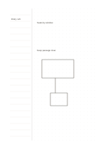

# Ruled cue rail and dot field

`column-dot-main` · `columns` · `a5-draft`

[繁體中文](README.zh-TW.md) · [English](README.en.md) · [日本語](README.ja.md) · [Back to catalog](../../docs/en/catalog.md)

List cues on narrow rules at left and draw their structure in the dot field at right.

## When to use it

- List three concepts and then show connections between them.
- Write steps on the left and sketch an object layout on the right.

## How to use it

1. Write one short cue on each left-hand line.
2. Use right-hand dots for positions, boxes, or arrows related to those cues.
3. Check which cues have a visual counterpart and flag any that do not.

## What the page helps you see

Parallel notes whose agreements, differences, and unanswered points can be checked.

## Worked example

A fictional garden's entrance and seats are listed at left, positioned at right, and joined by a route.

[SVG](examples/en.svg)

## When not to use it

Long prose lacks baselines in the dot field, and exact dimensions still need separate notation.

## Downloads

- [Wordless SVG](exports/a5-draft/blank.svg)
- [Wordless PDF](exports/a5-draft/blank.pdf)
- [PDF with English name at top left](exports/a5-draft/titled.pdf)
- [Darker-ink wordless PDF](exports/a5-contrast/blank.pdf)
- [Darker-ink SVG](exports/a5-contrast/blank.svg)

The English name appears only on the titled PDF; the wordless version remains available for free writing.

Page size: A5 (148 × 210 mm); profile: `a5-draft`.

## Provenance and status

Original mixed layout · Detailed source record: [manifest.json](manifest.json)  
[MIT license scope](../../LICENSE-SCOPE.md)

[Trilingual glossary](../../docs/en/glossary.md)

## Modify and rebuild

Change `profiles/a5-draft.json` or the corresponding builder in `src/noteformats/layouts/`, then run from the project root:

`python scripts/build.py --ids column-dot-main`
