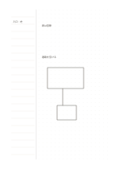

# 左罫線・右ドット

`column-dot-main` · `columns` · `a5-draft`

[繁體中文](README.zh-TW.md) · [English](README.en.md) · [日本語](README.ja.md) · [一覧へ戻る](../../docs/ja/catalog.md)

左欄に手がかりを一行ずつ並べ、右の点で対応する構造を描きます。

## 向いている場面

- 三つの概念を列挙し、つながりを描くとき。
- 左に手順を書き、右に物の配置を描くとき。

## 使い方

1. 左の各行に短い手がかりを一つ書きます。
2. 右の点を使って、対応する位置、枠、矢印を描きます。
3. 両側が対応しているか確かめ、対応しない語には印を付けます。

## 記入後に見えること

並べた記録から共通点、相違点、未確認事項を確かめられます。

## 記入例

架空の庭の入口と席を左に並べ、右でその位置と通り道を描いています。

[SVG](examples/ja.svg)

## 向いていない場面

長文には右の点だけでは書字線が不足し、正確な寸法も別に記す必要があります。

## ダウンロード

- [文字なしSVG](exports/a5-draft/blank.svg)
- [文字なしPDF](exports/a5-draft/blank.pdf)
- [左上に英語名があるPDF](exports/a5-draft/titled.pdf)
- [濃い線の文字なしPDF](exports/a5-contrast/blank.pdf)
- [濃い線のSVG](exports/a5-contrast/blank.svg)

英語名は表題付きPDFだけに印刷され、文字なし版は自由な記入に使えます。

用紙サイズ：A5（148 × 210 mm）。設定ファイル：`a5-draft`。

## 由来と状態

本プロジェクトの独自の複合配置 · 詳しい由来の記録： [manifest.json](manifest.json)  
[MITライセンスの範囲](../../LICENSE-SCOPE.md)

[三言語の用語集](../../docs/ja/glossary.md)

## 変更と再生成

`profiles/a5-draft.json` または `src/noteformats/layouts/` の描画関数を変更し、プロジェクトのルートで実行します：

`python scripts/build.py --ids column-dot-main`
