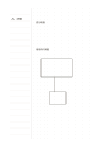

# 左線右點筆記

`column-dot-main` · `columns` · `a5-draft`

[繁體中文](README.zh-TW.md) · [English](README.en.md) · [日本語](README.ja.md) · [返回目錄](../../docs/zh-TW/catalog.md)

左欄逐行列線索，右側用點陣畫對應結構。

## 適合情境

- 列出三個概念後，畫出它們的連線。
- 左欄記步驟，右邊畫物件布局。

## 使用步驟

1. 在左側每行寫一個短線索。
2. 在右側點陣畫位置、框或箭頭，對照左欄項目。
3. 檢查兩側是否一一對應，沒有對應的線索另做記號。

## 整理後可得到

對照分欄內容，找出相同點、差異與待查證資訊。

## 實際填寫示例

示例左欄列虛構花園的入口與座位，右側把兩處畫在點陣上，並標出動線。

[SVG](examples/zh-TW.svg)

## 不適合情境

主內容全是長文時，點陣區缺少書寫基線；精密尺寸也需另標。

## 下載

- [無字 SVG](exports/a5-draft/blank.svg)
- [無字 PDF](exports/a5-draft/blank.pdf)
- [左上角英文名稱 PDF](exports/a5-draft/titled.pdf)
- [深色墨線無字 PDF](exports/a5-contrast/blank.pdf)
- [深色墨線 SVG](exports/a5-contrast/blank.svg)

英文名稱只印在標題版 PDF；無字版仍適合自由列印與改作。

頁面尺寸：A5（148 × 210 mm）；設定檔：`a5-draft`。

## 來源與狀態

本專案原創混合版面 · 詳細來源紀錄見 [manifest.json](manifest.json)  
[MIT 授權範圍](../../LICENSE-SCOPE.md)

[三語術語表](../../docs/zh-TW/glossary.md)

## 修改與重新生成

修改 `profiles/a5-draft.json` 或 `src/noteformats/layouts/` 內對應的繪圖函式，再於專案根目錄執行：

`python scripts/build.py --ids column-dot-main`
