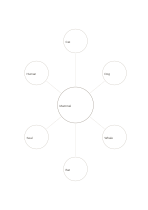

# Concept and six examples

`concept-examples-six` · `learning` · `a5-draft`

[繁體中文](README.zh-TW.md) · [English](README.en.md) · [日本語](README.ja.md) · [Back to catalog](../../docs/en/catalog.md)

Put one concept at the center and a concrete example on each of six branches.

## When to use it

**Geometry relationship:** `equivalent` · [mindmap-six](../mindmap-six/README.en.md)

- Put a concept such as mammals in the center and one qualifying example in each of six surrounding regions.
- Collect six different cases that illustrate a design principle you are learning.

## How to use it

1. Put one concept at the center and a concrete example on each of six branches.
2. Give each outer circle a different angle rather than a synonym.
3. Mark the angle that needs depth and continue on a blank page.

## What the page helps you see

Concepts, cues, and recalled answers that can be checked against one another.

## Worked example

Entries in example-position order; each number identifies one entry:

1. Mammal
2. Cat
3. Dog
4. Whale
5. Bat
6. Seal
7. Human

[SVG](examples/en.svg)

## When not to use it

Six examples are not an exhaustive or representative sample; similar cases can hide a concept's boundary, so add nonexamples or counterexamples elsewhere when needed.

## Downloads

- [Wordless SVG](exports/a5-draft/blank.svg)
- [Wordless PDF](exports/a5-draft/blank.pdf)
- [PDF with English name at top left](exports/a5-draft/titled.pdf)
- [Darker-ink wordless PDF](exports/a5-contrast/blank.pdf)
- [Darker-ink SVG](exports/a5-contrast/blank.svg)

The English name appears only on the titled PDF; the wordless version remains available for free writing.

Page size: A5 (148 × 210 mm); profile: `a5-draft`.

## Provenance and status

Common geometry · Detailed source record: [manifest.json](manifest.json)  
[MIT license scope](../../LICENSE-SCOPE.md)

[Trilingual glossary](../../docs/en/glossary.md)

## Modify and rebuild

Edit geometry in `src/noteformats/variants.py` or text in `src/noteformats/variant_content.py`, then run from the project root:

`python scripts/build.py --ids concept-examples-six`
