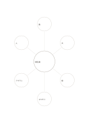

# 概念と六つの例

`concept-examples-six` · `learning` · `a5-draft`

[繁體中文](README.zh-TW.md) · [English](README.en.md) · [日本語](README.ja.md) · [一覧へ戻る](../../docs/ja/catalog.md)

中心に概念を置き、六つの枝に具体例を書きます。

## 向いている場面

**図形の対応:** `equivalent` · [mindmap-six](../mindmap-six/README.ja.md)

- 哺乳類などの概念を中心に置き、定義に合う具体例を周囲の六領域へ一つずつ書くとき。
- 学んでいる設計原則を説明できる、異なる六つの事例を集めるとき。

## 使い方

1. 中心に概念を置き、六つの枝に具体例を書きます。
2. 外側の円には同義語を重ねず、別々の観点を書きます。
3. 深掘りしたい観点を選び、詳細は別の紙に続けます。

## 記入後に見えること

概念、手がかり、思い出した答えを照合できます。

## 記入例

図の記入位置の順に示します。番号一つが一つの記入例です：

1. 哺乳類
2. 猫
3. 犬
4. 鯨
5. コウモリ
6. アザラシ
7. 人

[SVG](examples/ja.svg)

## 向いていない場面

六つの例は網羅的でも代表的な標本でもありません。似た例ばかりでは概念の境界が隠れるため、必要に応じて非例や反例を追加します。

## ダウンロード

- [文字なしSVG](exports/a5-draft/blank.svg)
- [文字なしPDF](exports/a5-draft/blank.pdf)
- [左上に英語名があるPDF](exports/a5-draft/titled.pdf)
- [濃い線の文字なしPDF](exports/a5-contrast/blank.pdf)
- [濃い線のSVG](exports/a5-contrast/blank.svg)

英語名は表題付きPDFだけに印刷され、文字なし版は自由な記入に使えます。

用紙サイズ：A5（148 × 210 mm）。設定ファイル：`a5-draft`。

## 由来と状態

一般的な幾何構造 · 詳しい由来の記録： [manifest.json](manifest.json)  
[MITライセンスの範囲](../../LICENSE-SCOPE.md)

[三言語の用語集](../../docs/ja/glossary.md)

## 変更と再生成

図形は `src/noteformats/variants.py`、文章は `src/noteformats/variant_content.py` を変更し、プロジェクトのルートで実行します：

`python scripts/build.py --ids concept-examples-six`
