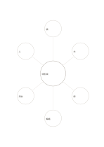

# 概念與六個例子

`concept-examples-six` · `learning` · `a5-draft`

[繁體中文](README.zh-TW.md) · [English](README.en.md) · [日本語](README.ja.md) · [返回目錄](../../docs/zh-TW/catalog.md)

中央寫概念，六個外圈各放一個具體例子。

## 適合情境

**幾何對照:** `equivalent` · [mindmap-six](../mindmap-six/README.zh-TW.md)

- 中央寫哺乳類等概念，外圍六區各放一個符合定義的具體例子。
- 學習一項設計原則時，蒐集六個可說明該原則的不同案例。

## 使用步驟

1. 中央寫概念，六個外圈各放一個具體例子。
2. 外圍六圈各寫一個不同的面向，不要重複同義詞。
3. 圈出需要深入的面向，另用空白頁補細節。

## 整理後可得到

把概念、線索與回想結果相互對照。

## 實際填寫示例

依圖中填寫位置順序列出，每個編號是一筆示例條目：

1. 哺乳類
2. 貓
3. 犬
4. 鯨
5. 蝙蝠
6. 海豹
7. 人

[SVG](examples/zh-TW.svg)

## 不適合情境

六個例子不是完整或具代表性的樣本；只選相似例子可能掩蓋概念邊界，必要時應另加非例與反例。

## 下載

- [無字 SVG](exports/a5-draft/blank.svg)
- [無字 PDF](exports/a5-draft/blank.pdf)
- [左上角英文名稱 PDF](exports/a5-draft/titled.pdf)
- [深色墨線無字 PDF](exports/a5-contrast/blank.pdf)
- [深色墨線 SVG](exports/a5-contrast/blank.svg)

英文名稱只印在標題版 PDF；無字版仍適合自由列印與改作。

頁面尺寸：A5（148 × 210 mm）；設定檔：`a5-draft`。

## 來源與狀態

通用幾何結構 · 詳細來源紀錄見 [manifest.json](manifest.json)  
[MIT 授權範圍](../../LICENSE-SCOPE.md)

[三語術語表](../../docs/zh-TW/glossary.md)

## 修改與重新生成

調整 `src/noteformats/variants.py` 的幾何或 `src/noteformats/variant_content.py` 的文字，再於專案根目錄執行：

`python scripts/build.py --ids concept-examples-six`
