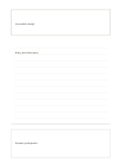

# Concept and recall area

`concept-recall` · `learning` · `a5-draft`

[繁體中文](README.zh-TW.md) · [English](README.en.md) · [日本語](README.ja.md) · [Back to catalog](../../docs/en/catalog.md)

Keep a new concept and notes separate from a final attempt to recall it in your own words.

## When to use it

- Test whether you can explain a short idea after studying it.
- Recall a reading group's main claim after reviewing notes.

## How to use it

1. Name the concept precisely at the top.
2. Record definitions, conditions, and questions in the middle.
3. Cover the middle, recall in your own words below, then check and correct.

## What the page helps you see

Concepts, cues, and recalled answers that can be checked against one another.

## Worked example

A fictional talk studies accessible design; notes cover entry and information, and the bottom recalls 'more people can participate' before checking.

[SVG](examples/en.svg)

## When not to use it

The bottom holds a brief summary, not proof of long-term retention; do not treat a mistaken recall as the source's wording.

## Downloads

- [Wordless SVG](exports/a5-draft/blank.svg)
- [Wordless PDF](exports/a5-draft/blank.pdf)
- [PDF with English name at top left](exports/a5-draft/titled.pdf)
- [Darker-ink wordless PDF](exports/a5-contrast/blank.pdf)
- [Darker-ink SVG](exports/a5-contrast/blank.svg)

The English name appears only on the titled PDF; the wordless version remains available for free writing.

Page size: A5 (148 × 210 mm); profile: `a5-draft`.

## Provenance and status

Original layout · Detailed source record: [manifest.json](manifest.json)  
[MIT license scope](../../LICENSE-SCOPE.md)

[Trilingual glossary](../../docs/en/glossary.md)

## Modify and rebuild

Change `profiles/a5-draft.json` or the corresponding builder in `src/noteformats/layouts/`, then run from the project root:

`python scripts/build.py --ids concept-recall`
