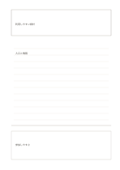

# 概念と想起の欄

`concept-recall` · `learning` · `a5-draft`

[繁體中文](README.zh-TW.md) · [English](README.en.md) · [日本語](README.ja.md) · [一覧へ戻る](../../docs/ja/catalog.md)

新しい概念と説明を記した後、離れた欄で自分の言葉による想起を試します。

## 向いている場面

- 短い概念を学んだ後で説明できるか確かめるとき。
- 読書会で主張の中心を思い出すとき。

## 使い方

1. 上に概念の名前を明確に書きます。
2. 中段に定義、条件、疑問を記します。
3. 中段を隠し、下段に自分の言葉で思い出してから照合し修正します。

## 記入後に見えること

概念、手がかり、思い出した答えを照合できます。

## 記入例

架空の講座で『利用しやすい設計』を学び、中段に入口と情報の条件を記し、下段で参加の広がりを思い出します。

[SVG](examples/ja.svg)

## 向いていない場面

下段は短い要約用です。長期記憶の証明にはならず、誤った想起を原文と混同しないでください。

## ダウンロード

- [文字なしSVG](exports/a5-draft/blank.svg)
- [文字なしPDF](exports/a5-draft/blank.pdf)
- [左上に英語名があるPDF](exports/a5-draft/titled.pdf)
- [濃い線の文字なしPDF](exports/a5-contrast/blank.pdf)
- [濃い線のSVG](exports/a5-contrast/blank.svg)

英語名は表題付きPDFだけに印刷され、文字なし版は自由な記入に使えます。

用紙サイズ：A5（148 × 210 mm）。設定ファイル：`a5-draft`。

## 由来と状態

本プロジェクトの独自レイアウト · 詳しい由来の記録： [manifest.json](manifest.json)  
[MITライセンスの範囲](../../LICENSE-SCOPE.md)

[三言語の用語集](../../docs/ja/glossary.md)

## 変更と再生成

`profiles/a5-draft.json` または `src/noteformats/layouts/` の描画関数を変更し、プロジェクトのルートで実行します：

`python scripts/build.py --ids concept-recall`
