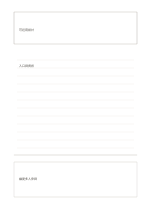

# 概念與回想區

`concept-recall` · `learning` · `a5-draft`

[繁體中文](README.zh-TW.md) · [English](README.en.md) · [日本語](README.ja.md) · [返回目錄](../../docs/zh-TW/catalog.md)

先記新概念與講解，最後隔開原文用自己的話回想。

## 適合情境

- 學完一個短概念後測試自己能否重新說明。
- 讀書會後整理主題並回想核心論點。

## 使用步驟

1. 上方寫清楚的概念名稱。
2. 中段寫資料中的定義、條件與疑問。
3. 遮住中段，在底部用自己的話回想，再回頭核對並修正。

## 整理後可得到

把概念、線索與回想結果相互對照。

## 實際填寫示例

虛構講座的主題是『可近用設計』；中段記入口與資訊條件，底部回想『讓更多人能參與』並查核。

[SVG](examples/zh-TW.svg)

## 不適合情境

底部只容短摘要；不適合用來證明已長期記住，也不要把錯誤回想當成原文。

## 下載

- [無字 SVG](exports/a5-draft/blank.svg)
- [無字 PDF](exports/a5-draft/blank.pdf)
- [左上角英文名稱 PDF](exports/a5-draft/titled.pdf)
- [深色墨線無字 PDF](exports/a5-contrast/blank.pdf)
- [深色墨線 SVG](exports/a5-contrast/blank.svg)

英文名稱只印在標題版 PDF；無字版仍適合自由列印與改作。

頁面尺寸：A5（148 × 210 mm）；設定檔：`a5-draft`。

## 來源與狀態

本專案原創版面 · 詳細來源紀錄見 [manifest.json](manifest.json)  
[MIT 授權範圍](../../LICENSE-SCOPE.md)

[三語術語表](../../docs/zh-TW/glossary.md)

## 修改與重新生成

修改 `profiles/a5-draft.json` 或 `src/noteformats/layouts/` 內對應的繪圖函式，再於專案根目錄執行：

`python scripts/build.py --ids concept-recall`
