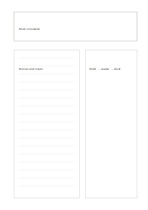

# Concept, text, and diagram

`concept-text-diagram` · `learning` · `a5-draft`

[繁體中文](README.zh-TW.md) · [English](README.en.md) · [日本語](README.ja.md) · [Back to catalog](../../docs/en/catalog.md)

Pair a written explanation with a sketch under one concept and check that the two agree.

## When to use it

- Learn a process by defining it and drawing its stages.
- Place a scientific description beside a relationship sketch.

## How to use it

1. Name the concept at the top.
2. Explain its definition, conditions, or process in your own words on the left.
3. Sketch it on the right, compare each part with the text, and correct mismatches.

## What the page helps you see

Concepts, cues, and recalled answers that can be checked against one another.

## Worked example

For a fictional library circulation process, the left describes borrowing and returning, while the right traces a book from shelf to reader and back.

[SVG](examples/en.svg)

## When not to use it

An unsupported sketch is not a factual model; use a formal chart for measured proportions.

## Downloads

- [Wordless SVG](exports/a5-draft/blank.svg)
- [Wordless PDF](exports/a5-draft/blank.pdf)
- [PDF with English name at top left](exports/a5-draft/titled.pdf)
- [Darker-ink wordless PDF](exports/a5-contrast/blank.pdf)
- [Darker-ink SVG](exports/a5-contrast/blank.svg)

The English name appears only on the titled PDF; the wordless version remains available for free writing.

Page size: A5 (148 × 210 mm); profile: `a5-draft`.

## Provenance and status

Original layout · Detailed source record: [manifest.json](manifest.json)  
[MIT license scope](../../LICENSE-SCOPE.md)

[Trilingual glossary](../../docs/en/glossary.md)

## Modify and rebuild

Change `profiles/a5-draft.json` or the corresponding builder in `src/noteformats/layouts/`, then run from the project root:

`python scripts/build.py --ids concept-text-diagram`
