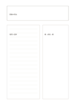

# 概念・文章・図

`concept-text-diagram` · `learning` · `a5-draft`

[繁體中文](README.zh-TW.md) · [English](README.en.md) · [日本語](README.ja.md) · [一覧へ戻る](../../docs/ja/catalog.md)

一つの概念を文章と手描きの図で表し、両者が合うか確かめます。

## 向いている場面

- 手順を定義すると同時に段階を描くとき。
- 科学的な説明と関係図を並べて読むとき。

## 使い方

1. 上に理解したい概念を書きます。
2. 左には定義、条件、過程を自分の言葉で書きます。
3. 右に図を描き、文章と一項目ずつ照らして食い違いを直します。

## 記入後に見えること

概念、手がかり、思い出した答えを照合できます。

## 記入例

架空の図書の貸出を題材に、左で借用と返却を説明し、右で本が棚から読者へ移り戻る線を描きます。

[SVG](examples/ja.svg)

## 向いていない場面

根拠のない図は事実のモデルではありません。測定した比率には正式なグラフを使います。

## ダウンロード

- [文字なしSVG](exports/a5-draft/blank.svg)
- [文字なしPDF](exports/a5-draft/blank.pdf)
- [左上に英語名があるPDF](exports/a5-draft/titled.pdf)
- [濃い線の文字なしPDF](exports/a5-contrast/blank.pdf)
- [濃い線のSVG](exports/a5-contrast/blank.svg)

英語名は表題付きPDFだけに印刷され、文字なし版は自由な記入に使えます。

用紙サイズ：A5（148 × 210 mm）。設定ファイル：`a5-draft`。

## 由来と状態

本プロジェクトの独自レイアウト · 詳しい由来の記録： [manifest.json](manifest.json)  
[MITライセンスの範囲](../../LICENSE-SCOPE.md)

[三言語の用語集](../../docs/ja/glossary.md)

## 変更と再生成

`profiles/a5-draft.json` または `src/noteformats/layouts/` の描画関数を変更し、プロジェクトのルートで実行します：

`python scripts/build.py --ids concept-text-diagram`
