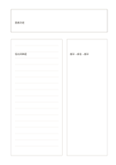

# 概念、文字與圖像

`concept-text-diagram` · `learning` · `a5-draft`

[繁體中文](README.zh-TW.md) · [English](README.en.md) · [日本語](README.ja.md) · [返回目錄](../../docs/zh-TW/catalog.md)

用一個概念連結文字解釋與手繪示意，檢查兩種表達是否一致。

## 適合情境

- 學習一個流程時，同時寫定義與畫步驟。
- 閱讀科學概念時，將描述和關係圖並置。

## 使用步驟

1. 上方寫要理解的概念。
2. 左側用自己的話寫定義、條件或過程。
3. 右側畫示意圖，再逐點對照左側文字，修正不一致處。

## 整理後可得到

把概念、線索與回想結果相互對照。

## 實際填寫示例

以虛構『圖書流通』為題，左側寫借出與歸還規則，右側畫書從書架到讀者再回到書架的路徑。

[SVG](examples/zh-TW.svg)

## 不適合情境

沒有資料支持的圖不等於事實模型；需要精密比例時另用正式圖表。

## 下載

- [無字 SVG](exports/a5-draft/blank.svg)
- [無字 PDF](exports/a5-draft/blank.pdf)
- [左上角英文名稱 PDF](exports/a5-draft/titled.pdf)
- [深色墨線無字 PDF](exports/a5-contrast/blank.pdf)
- [深色墨線 SVG](exports/a5-contrast/blank.svg)

英文名稱只印在標題版 PDF；無字版仍適合自由列印與改作。

頁面尺寸：A5（148 × 210 mm）；設定檔：`a5-draft`。

## 來源與狀態

本專案原創版面 · 詳細來源紀錄見 [manifest.json](manifest.json)  
[MIT 授權範圍](../../LICENSE-SCOPE.md)

[三語術語表](../../docs/zh-TW/glossary.md)

## 修改與重新生成

修改 `profiles/a5-draft.json` 或 `src/noteformats/layouts/` 內對應的繪圖函式，再於專案根目錄執行：

`python scripts/build.py --ids concept-text-diagram`
