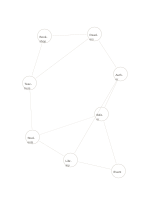

# Constellation relationship map

`constellation-network` · `concept-network` · `a5-draft`

[繁體中文](README.zh-TW.md) · [English](README.en.md) · [日本語](README.ja.md) · [Back to catalog](../../docs/en/catalog.md)

Record irregular links among elements without assuming a single center or rank.

## When to use it

- Trace characters in a fictional story.
- Explore links among venues, transport, times, and roles in a local service.

## How to use it

1. Give each point one identifiable element.
2. Mark known relationships along edges and remove unsupported ones.
3. Find dense areas, then add evidence and context on another page.

## What the page helps you see

A map of topics, branches, and relationships still to verify.

## Worked example

A fictional story connects a bookshop, readers, author, editor, event, library, students, and teachers as possible interactions.

[SVG](examples/en.svg)

## When not to use it

An edge does not measure strength or prove causation; use data tables for exact weights.

## Downloads

- [Wordless SVG](exports/a5-draft/blank.svg)
- [Wordless PDF](exports/a5-draft/blank.pdf)
- [PDF with English name at top left](exports/a5-draft/titled.pdf)
- [Darker-ink wordless PDF](exports/a5-contrast/blank.pdf)
- [Darker-ink SVG](exports/a5-contrast/blank.svg)

The English name appears only on the titled PDF; the wordless version remains available for free writing.

Page size: A5 (148 × 210 mm); profile: `a5-draft`.

## Provenance and status

Original layout · Detailed source record: [manifest.json](manifest.json)  
[MIT license scope](../../LICENSE-SCOPE.md)

[Trilingual glossary](../../docs/en/glossary.md)

## Modify and rebuild

Change `profiles/a5-draft.json` or the corresponding builder in `src/noteformats/layouts/`, then run from the project root:

`python scripts/build.py --ids constellation-network`
