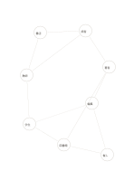

# 星座型の関係図

`constellation-network` · `concept-network` · `a5-draft`

[繁體中文](README.zh-TW.md) · [English](README.en.md) · [日本語](README.ja.md) · [一覧へ戻る](../../docs/ja/catalog.md)

中心や順位を決めず、要素間の不規則なつながりを書きます。

## 向いている場面

- 架空の物語の登場人物の関係を見るとき。
- 地域サービスで場所、交通、時間、役割の関係を探るとき。

## 使い方

1. 各点に識別できる要素を一つ置きます。
2. 分かっている関係だけ線に沿って記し、違う線は消します。
3. つながりの多い場所を見つけ、根拠は別紙に補います。

## 記入後に見えること

主題と枝、確かめ直す関係を一覧できます。

## 記入例

架空の物語に出る書店、読者、著者、編集者、催し、図書館、学生、教師の接点を探します。

[SVG](examples/ja.svg)

## 向いていない場面

線は関係の強さも因果も表しません。正確な重みが必要なら表のデータを使います。

## ダウンロード

- [文字なしSVG](exports/a5-draft/blank.svg)
- [文字なしPDF](exports/a5-draft/blank.pdf)
- [左上に英語名があるPDF](exports/a5-draft/titled.pdf)
- [濃い線の文字なしPDF](exports/a5-contrast/blank.pdf)
- [濃い線のSVG](exports/a5-contrast/blank.svg)

英語名は表題付きPDFだけに印刷され、文字なし版は自由な記入に使えます。

用紙サイズ：A5（148 × 210 mm）。設定ファイル：`a5-draft`。

## 由来と状態

本プロジェクトの独自レイアウト · 詳しい由来の記録： [manifest.json](manifest.json)  
[MITライセンスの範囲](../../LICENSE-SCOPE.md)

[三言語の用語集](../../docs/ja/glossary.md)

## 変更と再生成

`profiles/a5-draft.json` または `src/noteformats/layouts/` の描画関数を変更し、プロジェクトのルートで実行します：

`python scripts/build.py --ids constellation-network`
