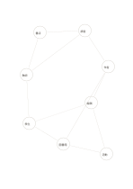

# 星座式關係網

`constellation-network` · `concept-network` · `a5-draft`

[繁體中文](README.zh-TW.md) · [English](README.en.md) · [日本語](README.ja.md) · [返回目錄](../../docs/zh-TW/catalog.md)

不預設主次，記下多個元素之間不規則的連結。

## 適合情境

- 分析一部虛構故事的人物關係。
- 探索地方服務中的場地、交通、時段與角色連結。

## 使用步驟

1. 每個點寫一個可辨識的元素。
2. 沿線標出已知關係，必要時刪除不成立的連結。
3. 尋找連結密集處，再另頁補充證據和脈絡。

## 整理後可得到

看見主題、分支及需要再確認的關係。

## 實際填寫示例

虛構故事將書店、讀者、作者、編輯、活動、圖書館、學生和教師連成可能的互動網。

[SVG](examples/zh-TW.svg)

## 不適合情境

線的存在不代表強度或因果；需要精確權重時應使用表格資料。

## 下載

- [無字 SVG](exports/a5-draft/blank.svg)
- [無字 PDF](exports/a5-draft/blank.pdf)
- [左上角英文名稱 PDF](exports/a5-draft/titled.pdf)
- [深色墨線無字 PDF](exports/a5-contrast/blank.pdf)
- [深色墨線 SVG](exports/a5-contrast/blank.svg)

英文名稱只印在標題版 PDF；無字版仍適合自由列印與改作。

頁面尺寸：A5（148 × 210 mm）；設定檔：`a5-draft`。

## 來源與狀態

本專案原創版面 · 詳細來源紀錄見 [manifest.json](manifest.json)  
[MIT 授權範圍](../../LICENSE-SCOPE.md)

[三語術語表](../../docs/zh-TW/glossary.md)

## 修改與重新生成

修改 `profiles/a5-draft.json` 或 `src/noteformats/layouts/` 內對應的繪圖函式，再於專案根目錄執行：

`python scripts/build.py --ids constellation-network`
