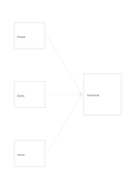

# Three inputs converge

`converging-flow` · `flow` · `a5-draft`

[繁體中文](README.zh-TW.md) · [English](README.en.md) · [日本語](README.ja.md) · [Back to catalog](../../docs/en/catalog.md)

Bring three inputs together toward one shared result or provisional decision.

## When to use it

- Combine three sources into a conclusion still to verify.
- Plan a gathering from people, materials, and venue conditions.

## How to use it

1. Give each left box a different input.
2. Follow each arrow and explain how its input informs the right-hand result.
3. Write only what the current information supports in the result box and mark gaps.

## What the page helps you see

A sequence, branch, or loop that can be traced along its arrows.

## Worked example

People, book choices, and venue feed a small trial plan for a fictional reading group.

[SVG](examples/en.svg)

## When not to use it

Arrows show information flow, not proven causation; a feedback loop needs a cycle diagram.

## Downloads

- [Wordless SVG](exports/a5-draft/blank.svg)
- [Wordless PDF](exports/a5-draft/blank.pdf)
- [PDF with English name at top left](exports/a5-draft/titled.pdf)
- [Darker-ink wordless PDF](exports/a5-contrast/blank.pdf)
- [Darker-ink SVG](exports/a5-contrast/blank.svg)

The English name appears only on the titled PDF; the wordless version remains available for free writing.

Page size: A5 (148 × 210 mm); profile: `a5-draft`.

## Provenance and status

Generic geometry · Detailed source record: [manifest.json](manifest.json)  
[MIT license scope](../../LICENSE-SCOPE.md)

[Trilingual glossary](../../docs/en/glossary.md)

## Modify and rebuild

Change `profiles/a5-draft.json` or the corresponding builder in `src/noteformats/layouts/`, then run from the project root:

`python scripts/build.py --ids converging-flow`
