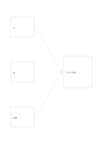

# 三方向からの合流

`converging-flow` · `flow` · `a5-draft`

[繁體中文](README.zh-TW.md) · [English](README.en.md) · [日本語](README.ja.md) · [一覧へ戻る](../../docs/ja/catalog.md)

三つの入力を一つの結果や暫定的な判断へ集めます。

## 向いている場面

- 三資料を合わせて確認待ちの結論を作るとき。
- 人、材料、会場の条件から催しを計画するとき。

## 使い方

1. 左の三枠に異なる入力を書きます。
2. 各矢印をたどり、右側の結果にどう関係するか説明します。
3. 結果欄には今言えることだけを書き、不足情報に印を付けます。

## 記入後に見えること

矢印に沿って順序、分岐、循環を追えます。

## 記入例

架空の読書会で人、本、会場を小規模な試行計画へまとめます。

[SVG](examples/ja.svg)

## 向いていない場面

矢印は情報の流れで、因果関係の証明ではありません。戻りがあるなら循環図を使います。

## ダウンロード

- [文字なしSVG](exports/a5-draft/blank.svg)
- [文字なしPDF](exports/a5-draft/blank.pdf)
- [左上に英語名があるPDF](exports/a5-draft/titled.pdf)
- [濃い線の文字なしPDF](exports/a5-contrast/blank.pdf)
- [濃い線のSVG](exports/a5-contrast/blank.svg)

英語名は表題付きPDFだけに印刷され、文字なし版は自由な記入に使えます。

用紙サイズ：A5（148 × 210 mm）。設定ファイル：`a5-draft`。

## 由来と状態

一般的な幾何構造 · 詳しい由来の記録： [manifest.json](manifest.json)  
[MITライセンスの範囲](../../LICENSE-SCOPE.md)

[三言語の用語集](../../docs/ja/glossary.md)

## 変更と再生成

`profiles/a5-draft.json` または `src/noteformats/layouts/` の描画関数を変更し、プロジェクトのルートで実行します：

`python scripts/build.py --ids converging-flow`
