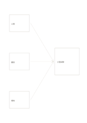

# 三路匯流

`converging-flow` · `flow` · `a5-draft`

[繁體中文](README.zh-TW.md) · [English](README.en.md) · [日本語](README.ja.md) · [返回目錄](../../docs/zh-TW/catalog.md)

把三項輸入收束到一個共同結果或決定。

## 適合情境

- 綜合三份資料形成待驗證結論。
- 從人員、材料與場地條件規劃一場活動。

## 使用步驟

1. 左側三框各寫一項不同輸入。
2. 沿箭頭確認每項如何影響右側結果。
3. 在結果框寫目前能支持的暫定結論，標出缺失資訊。

## 整理後可得到

沿箭頭追查步驟、分岔或循環的先後關係。

## 實際填寫示例

示例把虛構讀書會的人員、書目、場地匯入一次小型試辦計畫。

[SVG](examples/zh-TW.svg)

## 不適合情境

箭頭只表示資訊流，不證明三項因素有因果關係；需要回饋迴路時另選循環圖。

## 下載

- [無字 SVG](exports/a5-draft/blank.svg)
- [無字 PDF](exports/a5-draft/blank.pdf)
- [左上角英文名稱 PDF](exports/a5-draft/titled.pdf)
- [深色墨線無字 PDF](exports/a5-contrast/blank.pdf)
- [深色墨線 SVG](exports/a5-contrast/blank.svg)

英文名稱只印在標題版 PDF；無字版仍適合自由列印與改作。

頁面尺寸：A5（148 × 210 mm）；設定檔：`a5-draft`。

## 來源與狀態

通用幾何結構 · 詳細來源紀錄見 [manifest.json](manifest.json)  
[MIT 授權範圍](../../LICENSE-SCOPE.md)

[三語術語表](../../docs/zh-TW/glossary.md)

## 修改與重新生成

修改 `profiles/a5-draft.json` 或 `src/noteformats/layouts/` 內對應的繪圖函式，再於專案根目錄執行：

`python scripts/build.py --ids converging-flow`
