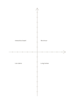

# Unnumbered coordinate axes

`coordinate-grid` · `geometry` · `a5-draft`

[繁體中文](README.zh-TW.md) · [English](README.en.md) · [日本語](README.ja.md) · [Back to catalog](../../docs/en/catalog.md)

Use two central axes and ticks to explore the direction and relative position of two quantities.

## When to use it

- Sketch positive and negative changes in two variables.
- Compare ideas on two dimensions you define.

## How to use it

1. Label the horizontal and vertical quantities yourself.
2. Decide what each tick means, or state that the drawing is only relative.
3. Plot items and check that a rough sketch is not mistaken for measured data.

## What the page helps you see

A draft of direction, proportion, or placement, with measurements still to check.

## Worked example

Four fictional event ideas are positioned by preparation time and attendance, to be checked against real figures later.

[SVG](examples/en.svg)

## When not to use it

Without printed units or values this is not a precise data chart. For four simple categories, a quadrant page may be clearer.

## Downloads

- [Wordless SVG](exports/a5-draft/blank.svg)
- [Wordless PDF](exports/a5-draft/blank.pdf)
- [PDF with English name at top left](exports/a5-draft/titled.pdf)
- [Darker-ink wordless PDF](exports/a5-contrast/blank.pdf)
- [Darker-ink SVG](exports/a5-contrast/blank.svg)

The English name appears only on the titled PDF; the wordless version remains available for free writing.

Page size: A5 (148 × 210 mm); profile: `a5-draft`.

## Provenance and status

Adaptation of traditional writing paper · Detailed source record: [manifest.json](manifest.json)  
[MIT license scope](../../LICENSE-SCOPE.md)

[Trilingual glossary](../../docs/en/glossary.md)

## Modify and rebuild

Change `profiles/a5-draft.json` or the corresponding builder in `src/noteformats/layouts/`, then run from the project root:

`python scripts/build.py --ids coordinate-grid`
