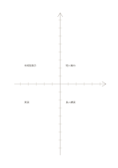

# 数字なしの座標軸

`coordinate-grid` · `geometry` · `a5-draft`

[繁體中文](README.zh-TW.md) · [English](README.en.md) · [日本語](README.ja.md) · [一覧へ戻る](../../docs/ja/catalog.md)

中央の二軸と目盛りで、二つの量の方向と相対的な位置を考えます。

## 向いている場面

- 二変数の正負の変化を下描きするとき。
- 自分で決めた二つの観点で複数の案を比べるとき。

## 使い方

1. 横軸と縦軸が表す量を自分で記します。
2. 各目盛りの単位を決めるか、相対位置だけの図だと明記します。
3. 項目を置き、草図を実測データと誤認しないよう確かめます。

## 記入後に見えること

向き、比率、配置と、追加で測る箇所が見えます。

## 記入例

架空の催し四案を準備時間と参加人数で仮に置き、あとで実数を調べる例です。

[SVG](examples/ja.svg)

## 向いていない場面

数字と単位がないため精密なグラフにはなりません。四分類だけなら4象限の方が明確です。

## ダウンロード

- [文字なしSVG](exports/a5-draft/blank.svg)
- [文字なしPDF](exports/a5-draft/blank.pdf)
- [左上に英語名があるPDF](exports/a5-draft/titled.pdf)
- [濃い線の文字なしPDF](exports/a5-contrast/blank.pdf)
- [濃い線のSVG](exports/a5-contrast/blank.svg)

英語名は表題付きPDFだけに印刷され、文字なし版は自由な記入に使えます。

用紙サイズ：A5（148 × 210 mm）。設定ファイル：`a5-draft`。

## 由来と状態

伝統的な練習紙の応用 · 詳しい由来の記録： [manifest.json](manifest.json)  
[MITライセンスの範囲](../../LICENSE-SCOPE.md)

[三言語の用語集](../../docs/ja/glossary.md)

## 変更と再生成

`profiles/a5-draft.json` または `src/noteformats/layouts/` の描画関数を変更し、プロジェクトのルートで実行します：

`python scripts/build.py --ids coordinate-grid`
