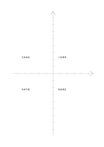

# 無數字座標軸

`coordinate-grid` · `geometry` · `a5-draft`

[繁體中文](README.zh-TW.md) · [English](README.en.md) · [日本語](README.ja.md) · [返回目錄](../../docs/zh-TW/catalog.md)

用兩條中央軸與刻線觀察兩個量的方向和相對位置。

## 適合情境

- 草擬兩個變數的正負變化。
- 比較幾個構想在兩個自訂面向上的位置。

## 使用步驟

1. 先在紙上自行標明橫軸與縱軸代表的量。
2. 決定每段刻線的單位，或註明只比較相對位置。
3. 標出項目，檢查是否誤把草圖當精確數據。

## 整理後可得到

看出方向、比例或空間配置中需要再測量之處。

## 實際填寫示例

示例以虛構活動的準備時間與參與人數為兩軸，暫放四個構想，之後再查數值。

[SVG](examples/zh-TW.svg)

## 不適合情境

未印數字與單位，不能直接用於精密數據圖；若只要四類分組，可用四象限。

## 下載

- [無字 SVG](exports/a5-draft/blank.svg)
- [無字 PDF](exports/a5-draft/blank.pdf)
- [左上角英文名稱 PDF](exports/a5-draft/titled.pdf)
- [深色墨線無字 PDF](exports/a5-contrast/blank.pdf)
- [深色墨線 SVG](exports/a5-contrast/blank.svg)

英文名稱只印在標題版 PDF；無字版仍適合自由列印與改作。

頁面尺寸：A5（148 × 210 mm）；設定檔：`a5-draft`。

## 來源與狀態

傳統書寫紙改編 · 詳細來源紀錄見 [manifest.json](manifest.json)  
[MIT 授權範圍](../../LICENSE-SCOPE.md)

[三語術語表](../../docs/zh-TW/glossary.md)

## 修改與重新生成

修改 `profiles/a5-draft.json` 或 `src/noteformats/layouts/` 內對應的繪圖函式，再於專案根目錄執行：

`python scripts/build.py --ids coordinate-grid`
