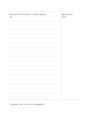

# Mirrored Cornell notes

`cornell-mirrored` · `columns` · `a5-draft`

[繁體中文](README.zh-TW.md) · [English](README.en.md) · [日本語](README.ja.md) · [Back to catalog](../../docs/en/catalog.md)

Move the Cornell cue column to the right, keeping main notes on the left and a summary below for recall.

## When to use it

**Geometry relationship:** `parameter` · [cornell](../cornell/README.en.md)

- Write lesson notes on the left and add self-test questions in the right cue column.
- Recall an article from right-hand keywords, then summarize the main points at the bottom.

## How to use it

1. Assign cue, main-note and summary roles using the mirrored left/right positions.
2. Use the worked example to place entries in region order: 1: "Light and leaf color?"; 2: "Window leaves look darker; compare watering too."; 3: "Correlation seen; cause not yet established."
3. Review the regions, mark open questions and choose a next step.

## What the page helps you see

Recall the main notes from the right-hand cues, then use the bottom summary to check understanding and questions.

## Worked example

Entries in example-position order; each number identifies one entry:

1. Light and leaf color?
2. Window leaves look darker; compare watering too.
3. Correlation seen; cause not yet established.

[SVG](examples/en.svg)

## When not to use it

The right cue column holds short questions or keywords; long answers, wide sketches and extended derivations may not fit, and mirroring alone does not establish a handwriting advantage.

## Downloads

- [Wordless SVG](exports/a5-draft/blank.svg)
- [Wordless PDF](exports/a5-draft/blank.pdf)
- [PDF with English name at top left](exports/a5-draft/titled.pdf)
- [Darker-ink wordless PDF](exports/a5-contrast/blank.pdf)
- [Darker-ink SVG](exports/a5-contrast/blank.svg)

The English name appears only on the titled PDF; the wordless version remains available for free writing.

Page size: A5 (148 × 210 mm); profile: `a5-draft`.

## Provenance and status

Adaptation of an existing method · Detailed source record: [manifest.json](manifest.json)  
[MIT license scope](../../LICENSE-SCOPE.md)

[Trilingual glossary](../../docs/en/glossary.md)

## Modify and rebuild

Edit geometry in `src/noteformats/variants.py` or text in `src/noteformats/variant_content.py`, then run from the project root:

`python scripts/build.py --ids cornell-mirrored`
