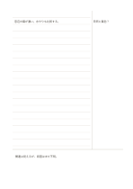

# 右に手がかり欄のコーネル式

`cornell-mirrored` · `columns` · `a5-draft`

[繁體中文](README.zh-TW.md) · [English](README.en.md) · [日本語](README.ja.md) · [一覧へ戻る](../../docs/ja/catalog.md)

コーネル式の手がかり欄を右に移し、左に本文、下に想起用のまとめを残します。

## 向いている場面

**図形の対応:** `parameter` · [cornell](../cornell/README.ja.md)

- 授業の本文を左に書き、右の手がかり欄へ自分への問いを追加するとき。
- 右欄の語句から記事の要点を思い出し、下部に要約するとき。

## 使い方

1. 左右反転後の位置に合わせ、手がかり・本文・要約の役割を決めます。
2. 記入例を参考に、領域の順で記します：1「日照と葉色？」；2「窓辺の葉が濃い。水やりも比較する。」；3「関連は見えるが、原因はまだ不明。」
3. 各領域を読み返し、未確認の点と次の行動を記します。

## 記入後に見えること

右の手がかり欄から左の本文を思い出し、下の要約で理解と疑問を確認できます。

## 記入例

図の記入位置の順に示します。番号一つが一つの記入例です：

1. 日照と葉色？
2. 窓辺の葉が濃い。水やりも比較する。
3. 関連は見えるが、原因はまだ不明。

[SVG](examples/ja.svg)

## 向いていない場面

右の手がかり欄は短い問いや語句向けです。長い答え、横長の図、連続した導出には狭く、左右反転だけで利き手への適性は決まりません。

## ダウンロード

- [文字なしSVG](exports/a5-draft/blank.svg)
- [文字なしPDF](exports/a5-draft/blank.pdf)
- [左上に英語名があるPDF](exports/a5-draft/titled.pdf)
- [濃い線の文字なしPDF](exports/a5-contrast/blank.pdf)
- [濃い線のSVG](exports/a5-contrast/blank.svg)

英語名は表題付きPDFだけに印刷され、文字なし版は自由な記入に使えます。

用紙サイズ：A5（148 × 210 mm）。設定ファイル：`a5-draft`。

## 由来と状態

既存の方法を配置に応用 · 詳しい由来の記録： [manifest.json](manifest.json)  
[MITライセンスの範囲](../../LICENSE-SCOPE.md)

[三言語の用語集](../../docs/ja/glossary.md)

## 変更と再生成

図形は `src/noteformats/variants.py`、文章は `src/noteformats/variant_content.py` を変更し、プロジェクトのルートで実行します：

`python scripts/build.py --ids cornell-mirrored`
