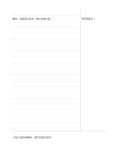

# 康乃爾式筆記頁（右提示欄）

`cornell-mirrored` · `columns` · `a5-draft`

[繁體中文](README.zh-TW.md) · [English](README.en.md) · [日本語](README.ja.md) · [返回目錄](../../docs/zh-TW/catalog.md)

把康乃爾提示欄移到右側，左側保留主筆記，下方總結用於回想。

## 適合情境

**幾何對照:** `parameter` · [cornell](../cornell/README.zh-TW.md)

- 把課堂主筆記寫在左側，再在右側提示欄補上自問問題。
- 用右欄關鍵詞回想左欄的文章重點，再於下方寫摘要。

## 使用步驟

1. 先按左右鏡像後的位置指定提示區、主內容區與摘要區的角色。
2. 參考本頁示例，各區依序記錄：1「日照與葉色？」；2「觀察：窗邊葉片較深。需比較澆水量。」；3「目前只看到相關性，還不能確定原因。」
3. 回看各區，標記仍待查證的內容，再決定下一步。

## 整理後可得到

用右側提示欄回想左側主筆記，再用頁末摘要核對理解與疑問。

## 實際填寫示例

依圖中填寫位置順序列出，每個編號是一筆示例條目：

1. 日照與葉色？
2. 觀察：窗邊葉片較深。需比較澆水量。
3. 目前只看到相關性，還不能確定原因。

[SVG](examples/zh-TW.svg)

## 不適合情境

右提示欄只宜短問題或關鍵詞；長篇問答、寬幅草圖與連續推導可能放不下，鏡像配置本身也不代表更適合某種慣用手。

## 下載

- [無字 SVG](exports/a5-draft/blank.svg)
- [無字 PDF](exports/a5-draft/blank.pdf)
- [左上角英文名稱 PDF](exports/a5-draft/titled.pdf)
- [深色墨線無字 PDF](exports/a5-contrast/blank.pdf)
- [深色墨線 SVG](exports/a5-contrast/blank.svg)

英文名稱只印在標題版 PDF；無字版仍適合自由列印與改作。

頁面尺寸：A5（148 × 210 mm）；設定檔：`a5-draft`。

## 來源與狀態

既有方法的版面改編 · 詳細來源紀錄見 [manifest.json](manifest.json)  
[MIT 授權範圍](../../LICENSE-SCOPE.md)

[三語術語表](../../docs/zh-TW/glossary.md)

## 修改與重新生成

調整 `src/noteformats/variants.py` 的幾何或 `src/noteformats/variant_content.py` 的文字，再於專案根目錄執行：

`python scripts/build.py --ids cornell-mirrored`
