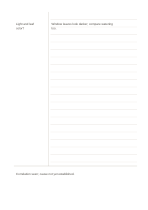

# Cornell notes

`cornell` · `columns` · `a5-draft`

[繁體中文](README.zh-TW.md) · [English](README.en.md) · [日本語](README.ja.md) · [Back to catalog](../../docs/en/catalog.md)

Separate recall cues, detailed notes, and a closing summary so the page can be reviewed actively.

## When to use it

- Take notes during a lesson, then add prompts after class.
- Check your understanding of a technical article with questions in the cue column.

## How to use it

1. Record the main material in the wide right area without trying to summarize perfectly while listening.
2. Afterward, write a question or key term in the left column for each important section.
3. Cover the right area and answer from the cues alone.
4. Write the main conclusion in your own words at the bottom, including anything still unclear.

## What the page helps you see

Use the cue column to recall with the main notes covered, then check understanding and open questions in the bottom summary.

## Worked example

A fictional plant observation lesson uses the main area for light and leaf observations, the cue column for a question about leaf color, and the bottom for a cautious conclusion.

[SVG](examples/en.svg)

## When not to use it

A large drawing or continuous mathematical derivation may be cramped by the narrow cue column.

## Downloads

- [Wordless SVG](exports/a5-draft/blank.svg)
- [Wordless PDF](exports/a5-draft/blank.pdf)
- [PDF with English name at top left](exports/a5-draft/titled.pdf)
- [Darker-ink wordless PDF](exports/a5-contrast/blank.pdf)
- [Darker-ink SVG](exports/a5-contrast/blank.svg)

The English name appears only on the titled PDF; the wordless version remains available for free writing.

Page size: A5 (148 × 210 mm); profile: `a5-draft`.

## Provenance and status

Adaptation of an existing method · Detailed source record: [manifest.json](manifest.json)  
[MIT license scope](../../LICENSE-SCOPE.md)

[Trilingual glossary](../../docs/en/glossary.md)

## Modify and rebuild

Change `profiles/a5-draft.json` or the corresponding builder in `src/noteformats/layouts/`, then run from the project root:

`python scripts/build.py --ids cornell`
