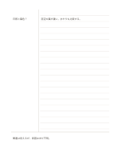

# コーネル式ノート

`cornell` · `columns` · `a5-draft`

[繁體中文](README.zh-TW.md) · [English](README.en.md) · [日本語](README.ja.md) · [一覧へ戻る](../../docs/ja/catalog.md)

手がかり、詳しい記録、最後の要約を分け、後から思い出しながら復習する形式です。

## 向いている場面

- 授業中に内容を記録し、授業後に問いを補うとき。
- 技術記事を読んだあと、左欄の問いで理解を確かめるとき。

## 使い方

1. 広い右欄に内容を記録します。聞きながら完全な要約を作る必要はありません。
2. 整理するとき、右欄のまとまりに対応する問いや語句を左欄に書きます。
3. 右欄を隠し、左欄だけを見て答えを説明してみます。
4. 下欄に最も大事な結論と、まだ分からない点を自分の言葉で書きます。

## 記入後に見えること

手がかり欄を見て本文を隠したまま思い出し、下の要約で理解と未確認点を確かめられます。

## 記入例

架空の植物観察授業を例に、右欄へ日照と葉の変化、左欄へ葉色の問い、下欄へ慎重な結論を書いています。

[SVG](examples/ja.svg)

## 向いていない場面

大きな図や連続した数式の展開には、手がかり欄が書く面積を圧迫する場合があります。

## ダウンロード

- [文字なしSVG](exports/a5-draft/blank.svg)
- [文字なしPDF](exports/a5-draft/blank.pdf)
- [左上に英語名があるPDF](exports/a5-draft/titled.pdf)
- [濃い線の文字なしPDF](exports/a5-contrast/blank.pdf)
- [濃い線のSVG](exports/a5-contrast/blank.svg)

英語名は表題付きPDFだけに印刷され、文字なし版は自由な記入に使えます。

用紙サイズ：A5（148 × 210 mm）。設定ファイル：`a5-draft`。

## 由来と状態

既存の方法を配置に応用 · 詳しい由来の記録： [manifest.json](manifest.json)  
[MITライセンスの範囲](../../LICENSE-SCOPE.md)

[三言語の用語集](../../docs/ja/glossary.md)

## 変更と再生成

`profiles/a5-draft.json` または `src/noteformats/layouts/` の描画関数を変更し、プロジェクトのルートで実行します：

`python scripts/build.py --ids cornell`
