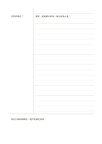

# 康乃爾式筆記頁

`cornell` · `columns` · `a5-draft`

[繁體中文](README.zh-TW.md) · [English](README.en.md) · [日本語](README.ja.md) · [返回目錄](../../docs/zh-TW/catalog.md)

把提示、詳細筆記與頁末摘要分開，方便回想與整理。

## 適合情境

- 聽課時先記內容，課後補上能引出答案的提示。
- 閱讀技術文章後，用側欄問題檢查自己是否理解。

## 使用步驟

1. 在右側較大的區域記下內容，不必邊聽邊寫完美摘要。
2. 整理時在左欄寫問題或關鍵詞，每一項對應右側的一段。
3. 遮住右側，試著只看左欄口述答案。
4. 在下方用自己的話寫出這頁最重要的結論，並標出仍不明白處。

## 整理後可得到

利用提示欄遮住主筆記自我回想，再用頁末摘要檢查理解與待補之處。

## 實際填寫示例

虛構的植物觀察課：右欄記日照與葉片變化，左欄提出『日照如何影響葉色？』，底欄寫目前可支持的簡短結論。

[SVG](examples/zh-TW.svg)

## 不適合情境

需要大幅繪圖或材料主要是連續數學推導時，狹窄提示欄可能浪費空間。

## 下載

- [無字 SVG](exports/a5-draft/blank.svg)
- [無字 PDF](exports/a5-draft/blank.pdf)
- [左上角英文名稱 PDF](exports/a5-draft/titled.pdf)
- [深色墨線無字 PDF](exports/a5-contrast/blank.pdf)
- [深色墨線 SVG](exports/a5-contrast/blank.svg)

英文名稱只印在標題版 PDF；無字版仍適合自由列印與改作。

頁面尺寸：A5（148 × 210 mm）；設定檔：`a5-draft`。

## 來源與狀態

既有方法的版面改編 · 詳細來源紀錄見 [manifest.json](manifest.json)  
[MIT 授權範圍](../../LICENSE-SCOPE.md)

[三語術語表](../../docs/zh-TW/glossary.md)

## 修改與重新生成

修改 `profiles/a5-draft.json` 或 `src/noteformats/layouts/` 內對應的繪圖函式，再於專案根目錄執行：

`python scripts/build.py --ids cornell`
