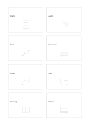

# Crazy eight idea sketch

`crazy-eight` · `ideation` · `a5-draft`

[繁體中文](README.zh-TW.md) · [English](README.en.md) · [日本語](README.ja.md) · [Back to catalog](../../docs/en/catalog.md)

Sketch one quick idea in each of eight cells, preserving differences before selection.

## When to use it

**Geometry relationship:** `parameter` · [four-cards](../four-cards/README.en.md)

- Quickly sketch eight different compositions for one poster before choosing a favorite.
- Use a time limit to explore eight service-entry sketches, then compare and combine them.

## How to use it

1. Decide whether cards hold options or facets of one topic; use one comparable unit per card.
2. Use the worked example to place entries in region order: 1: "Poster"; 2: "Audio"; 3: "Tour"; 4: "Book desk"; 5: "Route"; 6: "Q&A"; 7: "Reading"; 8: "Online"
3. Review the regions, mark open questions and choose a next step.

## What the page helps you see

Multiple proposals with a basis for the next selection step.

## Worked example

Entries in example-position order; each number identifies one entry:

1. Poster
2. Audio
3. Tour
4. Book desk
5. Route
6. Q&A
7. Reading
8. Online

[SVG](examples/en.svg)

## When not to use it

Eight rapid sketches do not replace feasibility checks or user feedback; redrawing the same idea to fill cells does not create useful variation.

## Downloads

- [Wordless SVG](exports/a5-draft/blank.svg)
- [Wordless PDF](exports/a5-draft/blank.pdf)
- [PDF with English name at top left](exports/a5-draft/titled.pdf)
- [Darker-ink wordless PDF](exports/a5-contrast/blank.pdf)
- [Darker-ink SVG](exports/a5-contrast/blank.svg)

The English name appears only on the titled PDF; the wordless version remains available for free writing.

Page size: A5 (148 × 210 mm); profile: `a5-draft`.

## Provenance and status

Generic geometry · Detailed source record: [manifest.json](manifest.json)  
[MIT license scope](../../LICENSE-SCOPE.md)

[Trilingual glossary](../../docs/en/glossary.md)

## Modify and rebuild

Edit geometry in `src/noteformats/variants.py` or text in `src/noteformats/variant_content.py`, then run from the project root:

`python scripts/build.py --ids crazy-eight`
