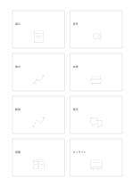

# 八コマの速い発想

`crazy-eight` · `ideation` · `a5-draft`

[繁體中文](README.zh-TW.md) · [English](README.en.md) · [日本語](README.ja.md) · [一覧へ戻る](../../docs/ja/catalog.md)

八コマに素早く一案ずつ描き、違いを残してから選びます。

## 向いている場面

**図形の対応:** `parameter` · [four-cards](../four-cards/README.ja.md)

- 同じポスターの異なる構図を八案素早く描き、描き終えてから好みを選ぶとき。
- 時間を区切ってサービスの入口を八案描き、その後に比較や組合せをするとき。

## 使い方

1. 各カードを案か観点に割り当て、一枚に比較できる単位を一つ置きます。
2. 記入例を参考に、領域の順で記します：1「展示」；2「音声」；3「案内」；4「本棚」；5「動線」；6「質問」；7「読書」；8「オンライン」
3. 各領域を読み返し、未確認の点と次の行動を記します。

## 記入後に見えること

複数の案と、次に選ぶための基準が残ります。

## 記入例

図の記入位置の順に示します。番号一つが一つの記入例です：

1. 展示
2. 音声
3. 案内
4. 本棚
5. 動線
6. 質問
7. 読書
8. オンライン

[SVG](examples/ja.svg)

## 向いていない場面

八案の素早いスケッチは実現性の確認や利用者の反応の代わりにはなりません。同じ案でマスを埋めても有用な違いは増えません。

## ダウンロード

- [文字なしSVG](exports/a5-draft/blank.svg)
- [文字なしPDF](exports/a5-draft/blank.pdf)
- [左上に英語名があるPDF](exports/a5-draft/titled.pdf)
- [濃い線の文字なしPDF](exports/a5-contrast/blank.pdf)
- [濃い線のSVG](exports/a5-contrast/blank.svg)

英語名は表題付きPDFだけに印刷され、文字なし版は自由な記入に使えます。

用紙サイズ：A5（148 × 210 mm）。設定ファイル：`a5-draft`。

## 由来と状態

一般的な幾何構造 · 詳しい由来の記録： [manifest.json](manifest.json)  
[MITライセンスの範囲](../../LICENSE-SCOPE.md)

[三言語の用語集](../../docs/ja/glossary.md)

## 変更と再生成

図形は `src/noteformats/variants.py`、文章は `src/noteformats/variant_content.py` を変更し、プロジェクトのルートで実行します：

`python scripts/build.py --ids crazy-eight`
