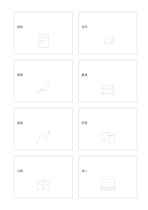

# 八格快速發想

`crazy-eight` · `ideation` · `a5-draft`

[繁體中文](README.zh-TW.md) · [English](README.en.md) · [日本語](README.ja.md) · [返回目錄](../../docs/zh-TW/catalog.md)

在八格各畫一個快速構想，先保留差異，之後才篩選。

## 適合情境

**幾何對照:** `parameter` · [four-cards](../four-cards/README.zh-TW.md)

- 為同一張海報快速畫八種不同構圖，完成前先不選最喜歡的一格。
- 限時發想服務入口的八個草圖方向，之後再比較與組合。

## 使用步驟

1. 先決定各卡是不同方案還是同一主題的不同面向，每張只放一個可比較單位。
2. 參考本頁示例，各區依序記錄：1「展板」；2「音訊」；3「導覽」；4「書桌」；5「路線」；6「問答」；7「共讀」；8「線上」
3. 回看各區，標記仍待查證的內容，再決定下一步。

## 整理後可得到

保留多種方案並說明下一輪篩選依據。

## 實際填寫示例

依圖中填寫位置順序列出，每個編號是一筆示例條目：

1. 展板
2. 音訊
3. 導覽
4. 書桌
5. 路線
6. 問答
7. 共讀
8. 線上

[SVG](examples/zh-TW.svg)

## 不適合情境

八格用來保留快速構想，不能替代可行性評估或使用者回饋；為湊格數重畫同一案，也不會增加方案差異。

## 下載

- [無字 SVG](exports/a5-draft/blank.svg)
- [無字 PDF](exports/a5-draft/blank.pdf)
- [左上角英文名稱 PDF](exports/a5-draft/titled.pdf)
- [深色墨線無字 PDF](exports/a5-contrast/blank.pdf)
- [深色墨線 SVG](exports/a5-contrast/blank.svg)

英文名稱只印在標題版 PDF；無字版仍適合自由列印與改作。

頁面尺寸：A5（148 × 210 mm）；設定檔：`a5-draft`。

## 來源與狀態

通用幾何結構 · 詳細來源紀錄見 [manifest.json](manifest.json)  
[MIT 授權範圍](../../LICENSE-SCOPE.md)

[三語術語表](../../docs/zh-TW/glossary.md)

## 修改與重新生成

調整 `src/noteformats/variants.py` 的幾何或 `src/noteformats/variant_content.py` 的文字，再於專案根目錄執行：

`python scripts/build.py --ids crazy-eight`
