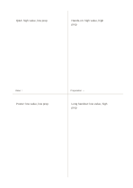

# Cross comparison

`cross-compare` · `comparison` · `a5-draft`

[繁體中文](README.zh-TW.md) · [English](README.en.md) · [日本語](README.ja.md) · [Back to catalog](../../docs/en/catalog.md)

Place four options on two chosen criteria and compare their tradeoffs across the cross.

## When to use it

**Geometry relationship:** `equivalent` · [quadrant](../quadrant/README.en.md)

- Place four event options across cost and reversibility criteria to compare tradeoffs.
- Classify four improvement proposals by preparation time and reach before choosing a trial.

## How to use it

1. Place four options on two chosen criteria and compare their tradeoffs across the cross.
2. Place each short idea in the area that fits best.
3. Put uncertain ideas near a boundary and note what needs checking.
4. Compare the distribution and choose what to test or investigate next.

## What the page helps you see

Options compared against shared criteria rather than one impression.

## Worked example

Entries in example-position order; each number identifies one entry:

1. Q&A: high value, low prep
2. Poster: low value, low prep
3. Hands-on: high value, high prep
4. Long handout: low value, high prep

[SVG](examples/en.svg)

## When not to use it

Many interdependent conditions or decisions requiring precise weights cannot be resolved by four areas alone. Small cells hold short phrases rather than long paragraphs.

## Downloads

- [Wordless SVG](exports/a5-draft/blank.svg)
- [Wordless PDF](exports/a5-draft/blank.pdf)
- [PDF with English name at top left](exports/a5-draft/titled.pdf)
- [Darker-ink wordless PDF](exports/a5-contrast/blank.pdf)
- [Darker-ink SVG](exports/a5-contrast/blank.svg)

The English name appears only on the titled PDF; the wordless version remains available for free writing.

Page size: A5 (148 × 210 mm); profile: `a5-draft`.

## Provenance and status

Generic geometry · Detailed source record: [manifest.json](manifest.json)  
[MIT license scope](../../LICENSE-SCOPE.md)

[Trilingual glossary](../../docs/en/glossary.md)

## Modify and rebuild

Edit geometry in `src/noteformats/variants.py` or text in `src/noteformats/variant_content.py`, then run from the project root:

`python scripts/build.py --ids cross-compare`
