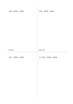

# 交差比較の四区画

`cross-compare` · `comparison` · `a5-draft`

[繁體中文](README.zh-TW.md) · [English](README.en.md) · [日本語](README.ja.md) · [一覧へ戻る](../../docs/ja/catalog.md)

二つの基準で四案を交差する領域に置き、取捨を比べます。

## 向いている場面

**図形の対応:** `equivalent` · [quadrant](../quadrant/README.ja.md)

- 四つの催し案を費用と戻しやすさの二基準で配置し、取捨を比べるとき。
- 四つの改善案を準備時間と影響範囲で分け、最初の試行を決めるとき。

## 使い方

1. 二つの基準で四案を交差する領域に置き、取捨を比べます。
2. 考えを短い言葉にし、最も近い領域に置きます。
3. 判断できない案は境界付近に置き、確認すべき条件を添えます。
4. 分布を比べ、次に試す案や調べる点を選びます。

## 記入後に見えること

同じ条件で選択肢を見比べ、一つの印象だけで決めることを避けられます。

## 記入例

図の記入位置の順に示します。番号一つが一つの記入例です：

1. 質問：高価値・低準備
2. 掲示：低価値・低準備
3. 実習：高価値・高準備
4. 長い資料：低価値・高準備

[SVG](examples/ja.svg)

## 向いていない場面

条件が複雑に依存する判断や、正確な重み付けが必要な判断は四つの領域だけでは扱えません。 小さなマスは短い語句向けで、長い文章には向きません。

## ダウンロード

- [文字なしSVG](exports/a5-draft/blank.svg)
- [文字なしPDF](exports/a5-draft/blank.pdf)
- [左上に英語名があるPDF](exports/a5-draft/titled.pdf)
- [濃い線の文字なしPDF](exports/a5-contrast/blank.pdf)
- [濃い線のSVG](exports/a5-contrast/blank.svg)

英語名は表題付きPDFだけに印刷され、文字なし版は自由な記入に使えます。

用紙サイズ：A5（148 × 210 mm）。設定ファイル：`a5-draft`。

## 由来と状態

一般的な幾何構造 · 詳しい由来の記録： [manifest.json](manifest.json)  
[MITライセンスの範囲](../../LICENSE-SCOPE.md)

[三言語の用語集](../../docs/ja/glossary.md)

## 変更と再生成

図形は `src/noteformats/variants.py`、文章は `src/noteformats/variant_content.py` を変更し、プロジェクトのルートで実行します：

`python scripts/build.py --ids cross-compare`
