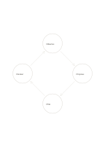

# Four-stage cycle

`cycle-four` · `flow` · `a5-draft`

[繁體中文](README.zh-TW.md) · [English](README.en.md) · [日本語](README.ja.md) · [Back to catalog](../../docs/en/catalog.md)

Show a repeatable process that returns from the fourth stage to the first.

## When to use it

- Organize observe, adjust, try, and review work.
- Explain a simplified material reuse loop.

## How to use it

1. Start at any node and name four actions in one pass.
2. Follow the arrows and explain what leads to the next action.
3. State when the loop stops or restarts rather than assuming endless repetition.

## What the page helps you see

A sequence, branch, or loop that can be traced along its arrows.

## Worked example

A fictional neighborhood activity moves through observe, propose, pilot, and review before observing again.

[SVG](examples/en.svg)

## When not to use it

A process with a final endpoint or irreversible stage should not be drawn as a perpetual cycle.

## Downloads

- [Wordless SVG](exports/a5-draft/blank.svg)
- [Wordless PDF](exports/a5-draft/blank.pdf)
- [PDF with English name at top left](exports/a5-draft/titled.pdf)
- [Darker-ink wordless PDF](exports/a5-contrast/blank.pdf)
- [Darker-ink SVG](exports/a5-contrast/blank.svg)

The English name appears only on the titled PDF; the wordless version remains available for free writing.

Page size: A5 (148 × 210 mm); profile: `a5-draft`.

## Provenance and status

Generic geometry · Detailed source record: [manifest.json](manifest.json)  
[MIT license scope](../../LICENSE-SCOPE.md)

[Trilingual glossary](../../docs/en/glossary.md)

## Modify and rebuild

Change `profiles/a5-draft.json` or the corresponding builder in `src/noteformats/layouts/`, then run from the project root:

`python scripts/build.py --ids cycle-four`
