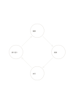

# 四段階の循環

`cycle-four` · `flow` · `a5-draft`

[繁體中文](README.zh-TW.md) · [English](README.en.md) · [日本語](README.ja.md) · [一覧へ戻る](../../docs/ja/catalog.md)

四番目から最初へ戻る繰り返しの過程を示します。

## 向いている場面

- 観察、調整、試行、振り返りを繰り返す仕事を整理するとき。
- 材料の再利用を簡単な循環で説明するとき。

## 使い方

1. どこから始めるか決め、一巡の四動作を書きます。
2. 矢印をたどり、次に進む理由を確認します。
3. いつ止めるか、再開するかを明示し、永遠の循環だと決めつけません。

## 記入後に見えること

矢印に沿って順序、分岐、循環を追えます。

## 記入例

架空の地域活動で観察、提案、試行、振り返りを経て再び観察します。

[SVG](examples/ja.svg)

## 向いていない場面

終点や元に戻れない段階がある過程を永久循環として描いてはいけません。

## ダウンロード

- [文字なしSVG](exports/a5-draft/blank.svg)
- [文字なしPDF](exports/a5-draft/blank.pdf)
- [左上に英語名があるPDF](exports/a5-draft/titled.pdf)
- [濃い線の文字なしPDF](exports/a5-contrast/blank.pdf)
- [濃い線のSVG](exports/a5-contrast/blank.svg)

英語名は表題付きPDFだけに印刷され、文字なし版は自由な記入に使えます。

用紙サイズ：A5（148 × 210 mm）。設定ファイル：`a5-draft`。

## 由来と状態

一般的な幾何構造 · 詳しい由来の記録： [manifest.json](manifest.json)  
[MITライセンスの範囲](../../LICENSE-SCOPE.md)

[三言語の用語集](../../docs/ja/glossary.md)

## 変更と再生成

`profiles/a5-draft.json` または `src/noteformats/layouts/` の描画関数を変更し、プロジェクトのルートで実行します：

`python scripts/build.py --ids cycle-four`
