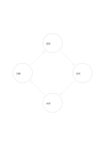

# 四段循環

`cycle-four` · `flow` · `a5-draft`

[繁體中文](README.zh-TW.md) · [English](README.en.md) · [日本語](README.ja.md) · [返回目錄](../../docs/zh-TW/catalog.md)

用四個節點表示會回到起點的反覆過程。

## 適合情境

- 整理觀察、調整、試行與回顧的反覆工作。
- 說明材料再使用的簡化循環。

## 使用步驟

1. 從任一節點開始，先寫一輪的四個動作。
2. 沿箭頭檢查每一步如何引出下一步。
3. 說明何時停止或重新開始，不要把循環誤當永久保證。

## 整理後可得到

沿箭頭追查步驟、分岔或循環的先後關係。

## 實際填寫示例

示例是虛構社區活動的觀察、提案、試辦、回顧，再回到觀察。

[SVG](examples/zh-TW.svg)

## 不適合情境

有明確終點或不可逆階段的流程，不該被畫成永遠回圈。

## 下載

- [無字 SVG](exports/a5-draft/blank.svg)
- [無字 PDF](exports/a5-draft/blank.pdf)
- [左上角英文名稱 PDF](exports/a5-draft/titled.pdf)
- [深色墨線無字 PDF](exports/a5-contrast/blank.pdf)
- [深色墨線 SVG](exports/a5-contrast/blank.svg)

英文名稱只印在標題版 PDF；無字版仍適合自由列印與改作。

頁面尺寸：A5（148 × 210 mm）；設定檔：`a5-draft`。

## 來源與狀態

通用幾何結構 · 詳細來源紀錄見 [manifest.json](manifest.json)  
[MIT 授權範圍](../../LICENSE-SCOPE.md)

[三語術語表](../../docs/zh-TW/glossary.md)

## 修改與重新生成

修改 `profiles/a5-draft.json` 或 `src/noteformats/layouts/` 內對應的繪圖函式，再於專案根目錄執行：

`python scripts/build.py --ids cycle-four`
