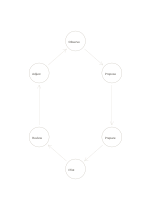

# Six-stage cycle

`cycle-six` · `flow` · `a5-draft`

[繁體中文](README.zh-TW.md) · [English](README.en.md) · [日本語](README.ja.md) · [Back to catalog](../../docs/en/catalog.md)

Arrange six stages as a repeatable loop and record what changes on the next pass. Geometry change: cycle nodes: 6.

## When to use it

**Geometry relationship:** `parameter` · [cycle-four](../cycle-four/README.en.md)

- Arrange observe, define, ideate, prototype, try and review as a six-stage improvement loop.
- Describe six reuse stages: collect, sort, clean, process, use and recover.

## How to use it

1. Fill stages in one rotational direction and check how the last returns to the first.
2. Use the worked example to place entries in region order: 1: "Observe"; 2: "Propose"; 3: "Prepare"; 4: "Pilot"; 5: "Review"; 6: "Adjust"
3. Review the regions, mark open questions and choose a next step.

## What the page helps you see

A sequence, branch, or loop that can be traced along its arrows.

## Worked example

Entries in example-position order; each number identifies one entry:

1. Observe
2. Propose
3. Prepare
4. Pilot
5. Review
6. Adjust

[SVG](examples/en.svg)

## When not to use it

A process with a final endpoint or irreversible stage should not be drawn as a perpetual cycle. Small cells hold short phrases rather than long paragraphs.

## Downloads

- [Wordless SVG](exports/a5-draft/blank.svg)
- [Wordless PDF](exports/a5-draft/blank.pdf)
- [PDF with English name at top left](exports/a5-draft/titled.pdf)
- [Darker-ink wordless PDF](exports/a5-contrast/blank.pdf)
- [Darker-ink SVG](exports/a5-contrast/blank.svg)

The English name appears only on the titled PDF; the wordless version remains available for free writing.

Page size: A5 (148 × 210 mm); profile: `a5-draft`.

## Provenance and status

Generic geometry · Detailed source record: [manifest.json](manifest.json)  
[MIT license scope](../../LICENSE-SCOPE.md)

[Trilingual glossary](../../docs/en/glossary.md)

## Modify and rebuild

Edit geometry in `src/noteformats/variants.py` or text in `src/noteformats/variant_content.py`, then run from the project root:

`python scripts/build.py --ids cycle-six`
