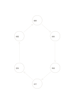

# 六段階の循環

`cycle-six` · `flow` · `a5-draft`

[繁體中文](README.zh-TW.md) · [English](README.en.md) · [日本語](README.ja.md) · [一覧へ戻る](../../docs/ja/catalog.md)

六段階を出発点に戻る循環として並べ、次回の調整を記録します。 図形の変更： 循環の節点数: 6.

## 向いている場面

**図形の対応:** `parameter` · [cycle-four](../cycle-four/README.ja.md)

- 観察・課題設定・発想・試作・試用・振り返りを六段階の改善循環にするとき。
- 収集・分類・洗浄・加工・使用・回収の六段階で再利用の流れを説明するとき。

## 使い方

1. 一定の回転方向で段階を記し、最後から最初へ戻る条件を確認します。
2. 記入例を参考に、領域の順で記します：1「観察」；2「提案」；3「準備」；4「試行」；5「感想」；6「調整」
3. 各領域を読み返し、未確認の点と次の行動を記します。

## 記入後に見えること

矢印に沿って順序、分岐、循環を追えます。

## 記入例

図の記入位置の順に示します。番号一つが一つの記入例です：

1. 観察
2. 提案
3. 準備
4. 試行
5. 感想
6. 調整

[SVG](examples/ja.svg)

## 向いていない場面

終点や元に戻れない段階がある過程を永久循環として描いてはいけません。 小さなマスは短い語句向けで、長い文章には向きません。

## ダウンロード

- [文字なしSVG](exports/a5-draft/blank.svg)
- [文字なしPDF](exports/a5-draft/blank.pdf)
- [左上に英語名があるPDF](exports/a5-draft/titled.pdf)
- [濃い線の文字なしPDF](exports/a5-contrast/blank.pdf)
- [濃い線のSVG](exports/a5-contrast/blank.svg)

英語名は表題付きPDFだけに印刷され、文字なし版は自由な記入に使えます。

用紙サイズ：A5（148 × 210 mm）。設定ファイル：`a5-draft`。

## 由来と状態

一般的な幾何構造 · 詳しい由来の記録： [manifest.json](manifest.json)  
[MITライセンスの範囲](../../LICENSE-SCOPE.md)

[三言語の用語集](../../docs/ja/glossary.md)

## 変更と再生成

図形は `src/noteformats/variants.py`、文章は `src/noteformats/variant_content.py` を変更し、プロジェクトのルートで実行します：

`python scripts/build.py --ids cycle-six`
