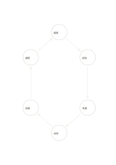

# 六段循環

`cycle-six` · `flow` · `a5-draft`

[繁體中文](README.zh-TW.md) · [English](README.en.md) · [日本語](README.ja.md) · [返回目錄](../../docs/zh-TW/catalog.md)

將六個階段排成可回到起點的循環，記錄每次調整。 本款的幾何變化： 循環節點數: 6.

## 適合情境

**幾何對照:** `parameter` · [cycle-four](../cycle-four/README.zh-TW.md)

- 將觀察、定題、發想、試作、試用、回顧排成六階段改善循環。
- 描述材料收集、分類、清理、加工、使用、回收的六步再利用路徑。

## 使用步驟

1. 沿同一旋轉方向填入各階段，最後一格要能回到起點。
2. 參考本頁示例，各區依序記錄：1「觀察」；2「提案」；3「準備」；4「試辦」；5「回饋」；6「調整」
3. 回看各區，標記仍待查證的內容，再決定下一步。

## 整理後可得到

沿箭頭追查步驟、分岔或循環的先後關係。

## 實際填寫示例

依圖中填寫位置順序列出，每個編號是一筆示例條目：

1. 觀察
2. 提案
3. 準備
4. 試辦
5. 回饋
6. 調整

[SVG](examples/zh-TW.svg)

## 不適合情境

有明確終點或不可逆階段的流程，不該被畫成永遠回圈。 細小格子只宜短語，不適合長篇段落。

## 下載

- [無字 SVG](exports/a5-draft/blank.svg)
- [無字 PDF](exports/a5-draft/blank.pdf)
- [左上角英文名稱 PDF](exports/a5-draft/titled.pdf)
- [深色墨線無字 PDF](exports/a5-contrast/blank.pdf)
- [深色墨線 SVG](exports/a5-contrast/blank.svg)

英文名稱只印在標題版 PDF；無字版仍適合自由列印與改作。

頁面尺寸：A5（148 × 210 mm）；設定檔：`a5-draft`。

## 來源與狀態

通用幾何結構 · 詳細來源紀錄見 [manifest.json](manifest.json)  
[MIT 授權範圍](../../LICENSE-SCOPE.md)

[三語術語表](../../docs/zh-TW/glossary.md)

## 修改與重新生成

調整 `src/noteformats/variants.py` 的幾何或 `src/noteformats/variant_content.py` 的文字，再於專案根目錄執行：

`python scripts/build.py --ids cycle-six`
