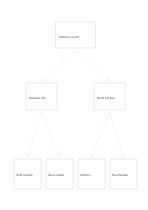

# Two-level decision tree

`decision-tree` · `flow` · `a5-draft`

[繁體中文](README.zh-TW.md) · [English](README.en.md) · [日本語](README.ja.md) · [Back to catalog](../../docs/en/catalog.md)

Branch one question into two checks and four possible actions.

## When to use it

- Plan weather backups for an event.
- Sketch a simple service troubleshooting route.

## How to use it

1. Put an answerable starting question at the top.
2. Give the middle branches clear, preferably exclusive conditions.
3. Write an action at each leaf and read every route back to the root.

## What the page helps you see

A sequence, branch, or loop that can be traced along its arrows.

## Worked example

A fictional outdoor reading group branches by weather and venue availability, ending in four arrangements.

[SVG](examples/en.svg)

## When not to use it

The tree does not calculate probabilities or weights; too many conditions also crowd an A5 page.

## Downloads

- [Wordless SVG](exports/a5-draft/blank.svg)
- [Wordless PDF](exports/a5-draft/blank.pdf)
- [PDF with English name at top left](exports/a5-draft/titled.pdf)
- [Darker-ink wordless PDF](exports/a5-contrast/blank.pdf)
- [Darker-ink SVG](exports/a5-contrast/blank.svg)

The English name appears only on the titled PDF; the wordless version remains available for free writing.

Page size: A5 (148 × 210 mm); profile: `a5-draft`.

## Provenance and status

Adaptation of a traditional format · Detailed source record: [manifest.json](manifest.json)  
[MIT license scope](../../LICENSE-SCOPE.md)

[Trilingual glossary](../../docs/en/glossary.md)

## Modify and rebuild

Change `profiles/a5-draft.json` or the corresponding builder in `src/noteformats/layouts/`, then run from the project root:

`python scripts/build.py --ids decision-tree`
