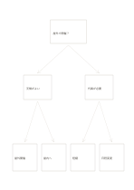

# 二層の判断ツリー

`decision-tree` · `flow` · `a5-draft`

[繁體中文](README.zh-TW.md) · [English](README.en.md) · [日本語](README.ja.md) · [一覧へ戻る](../../docs/ja/catalog.md)

一つの問いから二つの判断を経て四つの行動へ分けます。

## 向いている場面

- 天候による催しの代案を考えるとき。
- サービスの簡単な問題切り分けを設計するとき。

## 使い方

1. 答えられる始まりの問いを一番上に書きます。
2. 中段に明確な分岐条件を置き、条件が重なりすぎないか確かめます。
3. 下段に行動を書き、各経路を根元まで読み戻します。

## 記入後に見えること

矢印に沿って順序、分岐、循環を追えます。

## 記入例

架空の屋外読書会を天候と会場の空きで分け、四つの対応にたどり着く例です。

[SVG](examples/ja.svg)

## 向いていない場面

確率や重みは自動計算されず、条件が多いとA5では窮屈です。

## ダウンロード

- [文字なしSVG](exports/a5-draft/blank.svg)
- [文字なしPDF](exports/a5-draft/blank.pdf)
- [左上に英語名があるPDF](exports/a5-draft/titled.pdf)
- [濃い線の文字なしPDF](exports/a5-contrast/blank.pdf)
- [濃い線のSVG](exports/a5-contrast/blank.svg)

英語名は表題付きPDFだけに印刷され、文字なし版は自由な記入に使えます。

用紙サイズ：A5（148 × 210 mm）。設定ファイル：`a5-draft`。

## 由来と状態

伝統的な形式の応用 · 詳しい由来の記録： [manifest.json](manifest.json)  
[MITライセンスの範囲](../../LICENSE-SCOPE.md)

[三言語の用語集](../../docs/ja/glossary.md)

## 変更と再生成

`profiles/a5-draft.json` または `src/noteformats/layouts/` の描画関数を変更し、プロジェクトのルートで実行します：

`python scripts/build.py --ids decision-tree`
