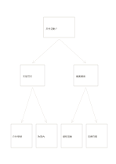

# 二層決策樹

`decision-tree` · `flow` · `a5-draft`

[繁體中文](README.zh-TW.md) · [English](README.en.md) · [日本語](README.ja.md) · [返回目錄](../../docs/zh-TW/catalog.md)

從一個問題分出兩個判斷，再抵達四個可能結果。

## 適合情境

- 討論活動在不同天候下的備案。
- 設計服務問題的簡單排查步驟。

## 使用步驟

1. 在頂端寫可回答的起始問題。
2. 第二層各放一個分岔條件，確認分岔互斥或清楚。
3. 在四個底端寫相應行動，逐路徑讀回起點。

## 整理後可得到

沿箭頭追查步驟、分岔或循環的先後關係。

## 實際填寫示例

示例以虛構戶外讀書會為根，先分天候，再分場地可用性，底端寫四種安排。

[SVG](examples/zh-TW.svg)

## 不適合情境

複雜決策、概率或權重不會由這張樹自動計算；太多條件也會擠滿 A5。

## 下載

- [無字 SVG](exports/a5-draft/blank.svg)
- [無字 PDF](exports/a5-draft/blank.pdf)
- [左上角英文名稱 PDF](exports/a5-draft/titled.pdf)
- [深色墨線無字 PDF](exports/a5-contrast/blank.pdf)
- [深色墨線 SVG](exports/a5-contrast/blank.svg)

英文名稱只印在標題版 PDF；無字版仍適合自由列印與改作。

頁面尺寸：A5（148 × 210 mm）；設定檔：`a5-draft`。

## 來源與狀態

傳統格式改編 · 詳細來源紀錄見 [manifest.json](manifest.json)  
[MIT 授權範圍](../../LICENSE-SCOPE.md)

[三語術語表](../../docs/zh-TW/glossary.md)

## 修改與重新生成

修改 `profiles/a5-draft.json` 或 `src/noteformats/layouts/` 內對應的繪圖函式，再於專案根目錄執行：

`python scripts/build.py --ids decision-tree`
