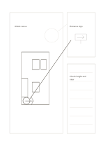

# Main and detail sketch

`detail-sketch` · `storyboard` · `a5-draft`

[繁體中文](README.zh-TW.md) · [English](README.en.md) · [日本語](README.ja.md) · [Back to catalog](../../docs/en/catalog.md)

Draw an overall idea and enlarge one area that needs discussion, with notes alongside.

## When to use it

- Explain an exhibition entrance and sign placement.
- Enlarge a connection in a product sketch.

## How to use it

1. Draw the whole on the left and circle one area of interest.
2. Sketch only that area in the upper-right inset.
3. Use the lower-right lines for materials, questions, or dimensions to verify.

## What the page helps you see

A visual sequence showing transitions and missing shots.

## Worked example

A fictional exhibition plan circles its entrance; the inset shows a sign, while notes ask about height and sightlines.

[SVG](examples/en.svg)

## When not to use it

The inset signals focus, not a measured enlargement ratio or a construction drawing.

## Downloads

- [Wordless SVG](exports/a5-draft/blank.svg)
- [Wordless PDF](exports/a5-draft/blank.pdf)
- [PDF with English name at top left](exports/a5-draft/titled.pdf)
- [Darker-ink wordless PDF](exports/a5-contrast/blank.pdf)
- [Darker-ink SVG](exports/a5-contrast/blank.svg)

The English name appears only on the titled PDF; the wordless version remains available for free writing.

Page size: A5 (148 × 210 mm); profile: `a5-draft`.

## Provenance and status

Original layout · Detailed source record: [manifest.json](manifest.json)  
[MIT license scope](../../LICENSE-SCOPE.md)

[Trilingual glossary](../../docs/en/glossary.md)

## Modify and rebuild

Change `profiles/a5-draft.json` or the corresponding builder in `src/noteformats/layouts/`, then run from the project root:

`python scripts/build.py --ids detail-sketch`
