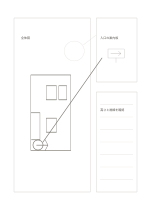

# 全体図と部分拡大

`detail-sketch` · `storyboard` · `a5-draft`

[繁體中文](README.zh-TW.md) · [English](README.en.md) · [日本語](README.ja.md) · [一覧へ戻る](../../docs/ja/catalog.md)

全体の草図を描き、話し合いたい一部分を拡大してメモを添えます。

## 向いている場面

- 展示の入口と案内板の位置を考えるとき。
- 製品スケッチの接合部分を拡大するとき。

## 使い方

1. 左に全体を描き、注目する一か所を丸で囲みます。
2. 右上にはその部分だけを描きます。
3. 右下に材料、疑問、確認する寸法を記します。

## 記入後に見えること

連続した場面から変化や足りないカットが見えます。

## 記入例

架空の展示計画で入口を囲み、右上に案内板、右下に高さと視線の確認点を書きます。

[SVG](examples/ja.svg)

## 向いていない場面

拡大枠は注目箇所を示すだけで、正確な倍率や施工図を意味しません。

## ダウンロード

- [文字なしSVG](exports/a5-draft/blank.svg)
- [文字なしPDF](exports/a5-draft/blank.pdf)
- [左上に英語名があるPDF](exports/a5-draft/titled.pdf)
- [濃い線の文字なしPDF](exports/a5-contrast/blank.pdf)
- [濃い線のSVG](exports/a5-contrast/blank.svg)

英語名は表題付きPDFだけに印刷され、文字なし版は自由な記入に使えます。

用紙サイズ：A5（148 × 210 mm）。設定ファイル：`a5-draft`。

## 由来と状態

本プロジェクトの独自レイアウト · 詳しい由来の記録： [manifest.json](manifest.json)  
[MITライセンスの範囲](../../LICENSE-SCOPE.md)

[三言語の用語集](../../docs/ja/glossary.md)

## 変更と再生成

`profiles/a5-draft.json` または `src/noteformats/layouts/` の描画関数を変更し、プロジェクトのルートで実行します：

`python scripts/build.py --ids detail-sketch`
