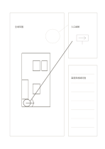

# 主圖與局部放大

`detail-sketch` · `storyboard` · `a5-draft`

[繁體中文](README.zh-TW.md) · [English](README.en.md) · [日本語](README.ja.md) · [返回目錄](../../docs/zh-TW/catalog.md)

畫整體草圖，再把一個需要討論的局部放大並加筆記。

## 適合情境

- 說明展場入口與指示牌的相對位置。
- 在產品草圖旁放大連接處的構想。

## 使用步驟

1. 左側先畫整體，圈出待說明的一處。
2. 右上只畫被圈選位置的局部，不把另一個整體草圖塞入。
3. 右下寫局部的材料、疑問或需要核對的尺寸。

## 整理後可得到

從連續畫面看出事件轉折與仍缺的鏡頭。

## 實際填寫示例

虛構展場左側畫全場，圈入口；右上放大入口指示牌，右下記『高度待量』與『轉角視線待查』。

[SVG](examples/zh-TW.svg)

## 不適合情境

放大框只示意關注點，不表示已標定倍率或真實尺寸。

## 下載

- [無字 SVG](exports/a5-draft/blank.svg)
- [無字 PDF](exports/a5-draft/blank.pdf)
- [左上角英文名稱 PDF](exports/a5-draft/titled.pdf)
- [深色墨線無字 PDF](exports/a5-contrast/blank.pdf)
- [深色墨線 SVG](exports/a5-contrast/blank.svg)

英文名稱只印在標題版 PDF；無字版仍適合自由列印與改作。

頁面尺寸：A5（148 × 210 mm）；設定檔：`a5-draft`。

## 來源與狀態

本專案原創版面 · 詳細來源紀錄見 [manifest.json](manifest.json)  
[MIT 授權範圍](../../LICENSE-SCOPE.md)

[三語術語表](../../docs/zh-TW/glossary.md)

## 修改與重新生成

修改 `profiles/a5-draft.json` 或 `src/noteformats/layouts/` 內對應的繪圖函式，再於專案根目錄執行：

`python scripts/build.py --ids detail-sketch`
