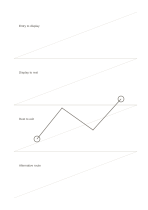

# Banded diagonal guides

`diagonal-guides` · `geometry` · `a5-draft`

[繁體中文](README.zh-TW.md) · [English](README.en.md) · [日本語](README.ja.md) · [Back to catalog](../../docs/en/catalog.md)

Use a diagonal in each of four broad bands to draft direction, slope, or change.

## When to use it

- Compare four ramp or object tilts.
- Show a viewer's movement direction across different sections.

## How to use it

1. Give each band one diagonal idea.
2. Draw the main direction along its guide and note start and end points.
3. Compare the four bands and select slopes that need real measurement.

## What the page helps you see

A draft of direction, proportion, or placement, with measurements still to check.

## Worked example

Four fictional exhibition routes are compared by drawing where each begins and ends.

[SVG](examples/en.svg)

## When not to use it

Sparse guides cannot calculate angles and are not a dense all-page grid.

## Downloads

- [Wordless SVG](exports/a5-draft/blank.svg)
- [Wordless PDF](exports/a5-draft/blank.pdf)
- [PDF with English name at top left](exports/a5-draft/titled.pdf)
- [Darker-ink wordless PDF](exports/a5-contrast/blank.pdf)
- [Darker-ink SVG](exports/a5-contrast/blank.svg)

The English name appears only on the titled PDF; the wordless version remains available for free writing.

Page size: A5 (148 × 210 mm); profile: `a5-draft`.

## Provenance and status

Original layout · Detailed source record: [manifest.json](manifest.json)  
[MIT license scope](../../LICENSE-SCOPE.md)

[Trilingual glossary](../../docs/en/glossary.md)

## Modify and rebuild

Change `profiles/a5-draft.json` or the corresponding builder in `src/noteformats/layouts/`, then run from the project root:

`python scripts/build.py --ids diagonal-guides`
