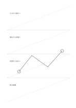

# 帯状の斜めガイド

`diagonal-guides` · `geometry` · `a5-draft`

[繁體中文](README.zh-TW.md) · [English](README.en.md) · [日本語](README.ja.md) · [一覧へ戻る](../../docs/ja/catalog.md)

四つの広い帯の斜線を使い、方向や傾きの案を描きます。

## 向いている場面

- 四つの坂道や物の傾き方を比べるとき。
- 区間ごとの視線の移動方向を描くとき。

## 使い方

1. 各帯では一つの斜め方向の案だけを扱います。
2. ガイドに沿って方向を描き、始点と終点を補います。
3. 四案を比べ、実測すべき傾きを選びます。

## 記入後に見えること

向き、比率、配置と、追加で測る箇所が見えます。

## 記入例

架空の展示会場で四つの誘導経路を比べ、それぞれの始点と終点を記しています。

[SVG](examples/ja.svg)

## 向いていない場面

まばらな線だけでは角度を計算できず、全面の細かな格子にもなりません。

## ダウンロード

- [文字なしSVG](exports/a5-draft/blank.svg)
- [文字なしPDF](exports/a5-draft/blank.pdf)
- [左上に英語名があるPDF](exports/a5-draft/titled.pdf)
- [濃い線の文字なしPDF](exports/a5-contrast/blank.pdf)
- [濃い線のSVG](exports/a5-contrast/blank.svg)

英語名は表題付きPDFだけに印刷され、文字なし版は自由な記入に使えます。

用紙サイズ：A5（148 × 210 mm）。設定ファイル：`a5-draft`。

## 由来と状態

本プロジェクトの独自レイアウト · 詳しい由来の記録： [manifest.json](manifest.json)  
[MITライセンスの範囲](../../LICENSE-SCOPE.md)

[三言語の用語集](../../docs/ja/glossary.md)

## 変更と再生成

`profiles/a5-draft.json` または `src/noteformats/layouts/` の描画関数を変更し、プロジェクトのルートで実行します：

`python scripts/build.py --ids diagonal-guides`
