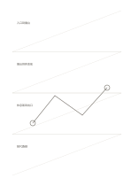

# 分帶斜向導線

`diagonal-guides` · `geometry` · `a5-draft`

[繁體中文](README.zh-TW.md) · [English](README.en.md) · [日本語](README.ja.md) · [返回目錄](../../docs/zh-TW/catalog.md)

以四段寬帶中的斜線協助草擬方向、坡度與變化。

## 適合情境

- 比較四種坡道或物件傾斜方式。
- 在不同區段畫出視線移動方向。

## 使用步驟

1. 讓每段只處理一種斜向構想。
2. 沿導線畫主要方向，旁邊補上起點和終點。
3. 比較四段後挑出需要實測的坡度。

## 整理後可得到

看出方向、比例或空間配置中需要再測量之處。

## 實際填寫示例

示例在四段中比較虛構展場的四種引導路線，分別記起點與終點。

[SVG](examples/zh-TW.svg)

## 不適合情境

稀疏導線不能直接計算角度，也不適合填滿整頁的密集格圖。

## 下載

- [無字 SVG](exports/a5-draft/blank.svg)
- [無字 PDF](exports/a5-draft/blank.pdf)
- [左上角英文名稱 PDF](exports/a5-draft/titled.pdf)
- [深色墨線無字 PDF](exports/a5-contrast/blank.pdf)
- [深色墨線 SVG](exports/a5-contrast/blank.svg)

英文名稱只印在標題版 PDF；無字版仍適合自由列印與改作。

頁面尺寸：A5（148 × 210 mm）；設定檔：`a5-draft`。

## 來源與狀態

本專案原創版面 · 詳細來源紀錄見 [manifest.json](manifest.json)  
[MIT 授權範圍](../../LICENSE-SCOPE.md)

[三語術語表](../../docs/zh-TW/glossary.md)

## 修改與重新生成

修改 `profiles/a5-draft.json` 或 `src/noteformats/layouts/` 內對應的繪圖函式，再於專案根目錄執行：

`python scripts/build.py --ids diagonal-guides`
