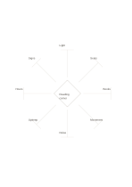

# Diamond center with eight rays

`diamond-eight-rays` · `mandala` · `a5-draft`

[繁體中文](README.zh-TW.md) · [English](README.en.md) · [日本語](README.ja.md) · [Back to catalog](../../docs/en/catalog.md)

Extend eight brief directions from one central diamond topic.

## When to use it

- Explore eight outside influences on a design idea.
- List eight discussion directions before a meeting.

## How to use it

1. Name one topic in the center.
2. Give each ray end a distinct short direction.
3. Compare which directions should merge or be developed on another page.

## What the page helps you see

Several directions to explore from a central topic.

## Worked example

A fictional public reading corner branches to light, seating, books, movement, noise, upkeep, hours, and signage.

[SVG](examples/en.svg)

## When not to use it

Ray ends fit only short notes, and their equal length does not encode importance.

## Downloads

- [Wordless SVG](exports/a5-draft/blank.svg)
- [Wordless PDF](exports/a5-draft/blank.pdf)
- [PDF with English name at top left](exports/a5-draft/titled.pdf)
- [Darker-ink wordless PDF](exports/a5-contrast/blank.pdf)
- [Darker-ink SVG](exports/a5-contrast/blank.svg)

The English name appears only on the titled PDF; the wordless version remains available for free writing.

Page size: A5 (148 × 210 mm); profile: `a5-draft`.

## Provenance and status

Original layout · Detailed source record: [manifest.json](manifest.json)  
[MIT license scope](../../LICENSE-SCOPE.md)

[Trilingual glossary](../../docs/en/glossary.md)

## Modify and rebuild

Change `profiles/a5-draft.json` or the corresponding builder in `src/noteformats/layouts/`, then run from the project root:

`python scripts/build.py --ids diamond-eight-rays`
