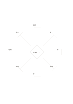

# ひし形中心の八方向

`diamond-eight-rays` · `mandala` · `a5-draft`

[繁體中文](README.zh-TW.md) · [English](README.en.md) · [日本語](README.ja.md) · [一覧へ戻る](../../docs/ja/catalog.md)

中央のひし形から八方向に伸ばし、各線に短い観点を置きます。

## 向いている場面

- 設計案に影響する八つの外的条件を探るとき。
- 会議前に八つの議論方向を素早く並べるとき。

## 使い方

1. 中央に一つの主題を書きます。
2. 八本の線の先に異なる短い観点を置きます。
3. まとめるべき観点や別のページで深める観点を探します。

## 記入後に見えること

中心のテーマから次に調べる方向を広げられます。

## 記入例

架空の公共読書コーナーから照明、席、本、動線、音、維持、時間、表示へ広げます。

[SVG](examples/ja.svg)

## 向いていない場面

線の先は短い注記用で、長い論証は入りません。線の長さは重要度を示しません。

## ダウンロード

- [文字なしSVG](exports/a5-draft/blank.svg)
- [文字なしPDF](exports/a5-draft/blank.pdf)
- [左上に英語名があるPDF](exports/a5-draft/titled.pdf)
- [濃い線の文字なしPDF](exports/a5-contrast/blank.pdf)
- [濃い線のSVG](exports/a5-contrast/blank.svg)

英語名は表題付きPDFだけに印刷され、文字なし版は自由な記入に使えます。

用紙サイズ：A5（148 × 210 mm）。設定ファイル：`a5-draft`。

## 由来と状態

本プロジェクトの独自レイアウト · 詳しい由来の記録： [manifest.json](manifest.json)  
[MITライセンスの範囲](../../LICENSE-SCOPE.md)

[三言語の用語集](../../docs/ja/glossary.md)

## 変更と再生成

`profiles/a5-draft.json` または `src/noteformats/layouts/` の描画関数を変更し、プロジェクトのルートで実行します：

`python scripts/build.py --ids diamond-eight-rays`
