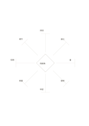

# 菱心八向放射

`diamond-eight-rays` · `mandala` · `a5-draft`

[繁體中文](README.zh-TW.md) · [English](README.en.md) · [日本語](README.ja.md) · [返回目錄](../../docs/zh-TW/catalog.md)

從中央菱形向八方伸展，讓每條射線承擔一個短方向。

## 適合情境

- 探索一個設計構想的八種外部影響。
- 在會議前快速列出八個討論方向。

## 使用步驟

1. 在中央寫清楚唯一主題。
2. 沿八條射線末端各寫一個不同方向。
3. 比較哪些方向需要合併或延伸，另頁詳述。

## 整理後可得到

從中心主題展開多個可再追問的面向。

## 實際填寫示例

示例以虛構公共閱讀角為核心，八端填入照明、座位、書、動線、噪音、維護、開放時間與標示。

[SVG](examples/zh-TW.svg)

## 不適合情境

端點只有短註空間，不能容納完整論證；射線長短不表示重要性。

## 下載

- [無字 SVG](exports/a5-draft/blank.svg)
- [無字 PDF](exports/a5-draft/blank.pdf)
- [左上角英文名稱 PDF](exports/a5-draft/titled.pdf)
- [深色墨線無字 PDF](exports/a5-contrast/blank.pdf)
- [深色墨線 SVG](exports/a5-contrast/blank.svg)

英文名稱只印在標題版 PDF；無字版仍適合自由列印與改作。

頁面尺寸：A5（148 × 210 mm）；設定檔：`a5-draft`。

## 來源與狀態

本專案原創版面 · 詳細來源紀錄見 [manifest.json](manifest.json)  
[MIT 授權範圍](../../LICENSE-SCOPE.md)

[三語術語表](../../docs/zh-TW/glossary.md)

## 修改與重新生成

修改 `profiles/a5-draft.json` 或 `src/noteformats/layouts/` 內對應的繪圖函式，再於專案根目錄執行：

`python scripts/build.py --ids diamond-eight-rays`
